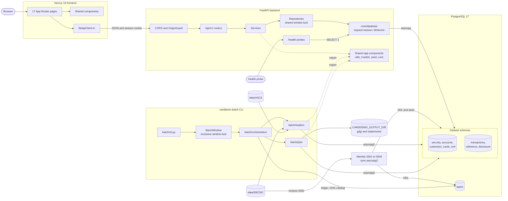

# CardDemo architecture: layers, cross-cutting decisions and components

This document describes how the modernized CardDemo application is built: its layers and module
layout, how the components connect, the patterns every online request follows, and the decisions
that cut across the frontend, the backend, batch and the database. It summarises. Where a contract
is fully specified in another document, this one links to it rather than restating it. Code that
contradicts a decision recorded here is a defect.

Related documents:

- [README.md](README.md): install, configuration and run instructions.
- [data-model.md](data-model.md): COBOL-to-Python types, rounding, timestamps, the schema, the
    Alembic revisions and the seed counts.
- [batch.md](batch.md): the job chain, cycles and step identity, GDG archives, the batch window
    and reconciliation.
- [traceability.md](traceability.md): each legacy artefact, its disposition and its target path.
- [api-reference.md](api-reference.md): every `/api/v1` endpoint with request and response
    samples, the error contract, the session cookie and the CSRF `Origin` requirement.

## System overview

The CardDemo base application is a set of CICS/COBOL online programs, VSAM KSDS datasets with
alternate indexes (AIX), JCL batch jobs and BMS 3270 maps. It is re-implemented as a Python 3.13.7
FastAPI backend, a PostgreSQL 17 database, a Python batch CLI built on Typer, and a Next.js 16
frontend that uses Material UI 9.2.0 themed with Material Design 3 tokens. Every business rule,
field edit, paging size and message literal behaves as the COBOL source does; the port changes the
technology, not the behaviour. The legacy sources stay at the repository root (`cbl/`, `cpy/`,
`bms/`, `cpy-bms/`, `jcl/`, `proc/`, `ctl/`, `data/` and the others listed in
[traceability.md](traceability.md)), read-only beside the new code. The `data/` images are also
the seed and batch input, read in place.

How each legacy mechanism is replaced:

| Legacy mechanism | Replacement |
|---|---|
| CICS transaction (17 base IDs) | One endpoint group under `/api/v1` and one Next.js page |
| COBOL online program | One service module in `backend/app/services/<cluster>/` |
| BMS map | One App Router `page.tsx` under `frontend/src/app/` |
| VSAM KSDS key, AIX | PostgreSQL primary key, index |
| COMMAREA | Session cookie, explicit request keys, `card_ref` and `screen_token` |
| `XCTL`, `RETURN TRANSID` | Frontend routes |
| PF keys | `FunctionKeyBar` buttons bound to the physical keys |
| RACF sign-on, USRSEC | `security.users`, bcrypt hashes and a signed session cookie |
| JCL job | One module under `batch/loaders/` or `batch/jobs/` |
| CA-7 and Control-M chains | `batch/orchestration/batch_chain.py` |
| CLOSEFIL, OPENFIL | The batch window (advisory locks) |
| GDG generations | File archives with the `batch.gdg_generations` catalog |
| CR00 TDQ job submission | The online report with CSV and PDF exports |

## Layers

| Layer | Path | Responsibility |
|---|---|---|
| Frontend | `frontend/src/**` | 17 pages, one per BMS map; no business decisions |
| API | `backend/app/api/**` | Eight `/api/v1` routers and the health probes |
| Services | `backend/app/services/**` | One module per COBOL program: edits and literals |
| Repositories | `backend/app/repositories/*.py` | One per VSAM file and access path |
| Data | `backend/app/models/`, `backend/alembic/` | Tables, revisions `0001`–`0009`, seed |
| Batch | `batch/**` | The CLI, loaders, jobs and orchestration |
| Database | PostgreSQL 17 | Eight dataset schemas and the `batch` schema |

### Frontend

- **Pages.** 17 App Router pages under `frontend/src/app/`, one per BMS map
    ([Map-to-page map](traceability.md#map-to-page-map)). Each renders its map's content as a
    responsive Material form: labels are the BMS `INITIAL` texts and input lengths the BMS
    `LENGTH` values.
- **Shared components** in `frontend/src/components/`:
    - `ScreenShell`: the header with the COTTL01Y titles, the legacy transaction ID and program
        name, and the current date and time.
    - `MessageLine`: the message line and the information line, with the legacy colour meaning
        (red errors, green confirmations), on an `aria-live` region.
    - `FunctionKeyBar`: the map's PF legend as buttons.
    - `SelectionTable`: the selection-code lists of COCRDLI, COTRN00 and COUSR00.
    - `ConfirmField`: the one-character Y/N confirm field.
- **Client library** in `frontend/src/lib/`:
    - `apiClient.ts`: axios with `baseURL = NEXT_PUBLIC_API_URL + "/api/v1"` and
        `withCredentials: true`. A 401 redirects to `/signon`. A 403 returns to the user's own
        menu with the server message. An unexpected error shows `UNEXPECTED ABEND OCCURRED.`.
    - `session.tsx`: the session context, read from `GET /api/v1/auth/me` only to choose the menu
        and fill the header.
    - `useFunctionKeys.ts`: binds F3, F4, F5, F7, F8 and F12 to the bar's buttons, so legacy
        literals that mention PF keys stay accurate. Any other PF1–PF24 key is kept from the
        browser and answered by the screen's optional invalid-key action: ENTER on CCLI, CCDL and
        CCUP; the `Invalid key pressed. Please see below...` literal on CT00, CT01, CT02, CR00 and
        CB00; nothing on the other screens.
    - `api/*.ts`: typed endpoint functions whose types mirror `backend/app/schemas/*.py` field for
        field, with snake_case JSON keys.
- **Theme.** `frontend/src/app/theme.ts` is the only source of colour, type, shape and spacing
    values, the Material Design 3 tokens. `frontend/src/theme/m3.d.ts` types its augmentations.
- **Navigation** replaces `XCTL`. Sign-on goes to `/admin` for user type `A` and to `/menu` for
    every other type. F3 returns to the owning menu; on a menu, F3 signs off. The keys the
    COMMAREA carried travel as the query parameters `acctId`, `tranId`, `userId` and `cardRef`.
- **No business decisions.** The frontend shows server messages verbatim, marks every field
    named in `field_errors`, and moves focus to `cursor_field`.

### API

- **Application factory.** `CreateApp()` in `backend/app/main.py` builds the app in this order:
    1. `ConfigureLogging()`, so card numbers are masked in every record the app and Uvicorn
        write.
    2. The FastAPI app, with `/docs`, `/redoc` and `/openapi.json` only when the docs are enabled
        ([Health probes and API documentation](#health-probes-and-api-documentation)).
    3. The settings, the lazily connecting async engine and its session factory on `app.state`.
    4. `OriginGuard`, then CORS as the outermost layer, around Starlette's error middleware, so
        CORS answers preflight requests and decorates the guard's 403 and an unexpected 500.
    5. The `LegacyMessageError`, request-validation and HTTP-exception handlers, and no other.
    6. The health router at the root and the `/api/v1` router.
- **Routers.** `backend/app/api/v1/router.py` aggregates the eight cluster routers under
    `/api/v1`: `auth.py`, `menu.py`, `accounts.py`, `cards.py`, `transactions.py`, `reports.py`,
    `billpay.py` and `admin_users.py`. Each handler calls one service function. Paths, roles and
    models are listed in [api-reference.md](api-reference.md) and
    [Endpoints, modules and pages](traceability.md#endpoints-modules-and-pages).
- **Health.** `backend/app/api/health.py` serves `GET /health` and `GET /health/ready`, outside
    `/api/v1`.
- **Schemas.** `backend/app/schemas/*.py` hold the request and response models
    ([Screen input](#screen-input)).
- **Core.** `backend/app/core/` holds the settings (`config.py`), the engine, request session and
    write units (`database.py`), the identity and role dependencies (`dependencies.py`), the
    origin guard (`middleware.py`), the error contract (`errors.py`), the shared literals
    (`messages.py`), security, locks, paths and logging.

### Services

- `backend/app/services/<cluster>/<program>.py`, in eight clusters: `auth`, `menu`, `accounts`,
    `cards`, `transactions`, `reports`, `billpay` and `users`. Every ported COBOL program has
    exactly one module ([Program-to-module map](traceability.md#program-to-module-map)).
- Each module opens with a header naming the program, copybooks and BMS map it replaces, and
    exposes one public function per user action, for example `coactupc.FetchAccountForEdit`.
- Each applies the program's edits in source order and in the program's edit mode
    ([Edit modes](#edit-modes)), and keeps the program's literals as module constants. Literals
    shared by several programs live in `backend/app/core/messages.py`.

### Repositories

One repository per VSAM file and access path, so services keep the legacy access patterns:

| Repository | VSAM file and path |
|---|---|
| `user_repository.py` | USRSEC |
| `account_repository.py` | ACCTDAT |
| `customer_repository.py` | CUSTDAT |
| `card_repository.py` | CARDDAT |
| `card_xref_repository.py` | CCXREF, and its AIX path CXACAIX |
| `transaction_repository.py` | TRANSACT |
| `reference_repository.py` | TRANTYPE, TRANCATG |

They provide keyed reads, `FOR UPDATE` reads, keyset browses forward and backward, AIX lookups and
`AllocateNextTranId`, with bound parameters only. Database failures become the `RepositoryError`
family of `backend/app/core/errors.py` (`RecordNotFoundError`, `DuplicateKeyError`,
`RecordLockError`, `FileIoError`, and `FileNotOpenError` for the batch window), so each service
reaches the branch the program it ports has for that file condition.

### Data

- `backend/app/models/`: eleven ORM models, one per dataset layout including the
    `daily_transactions` staging table, plus the SQLAlchemy Core tables of `support_tables.py`
    for the login throttle and the batch ledger and catalog.
- `backend/alembic/versions/`: revisions `0001` to `0009`, head `0009`
    ([Alembic revisions](data-model.md#alembic-revisions)).
- `backend/app/seed/`: `image_reader.py` (`ReadImage`) and `sample_seed.py` (`LoadSampleData`),
    which revision `0002` uses to seed from the EBCDIC images when `APP_ENV` is `local` or `test`.

Column definitions, types and truncation rules are in [data-model.md](data-model.md).

### Batch

- `batch/cli.py`: the Typer app `APP`, installed as the `carddemo-batch` console script, with the
    `run-all`, `seed-all`, `job` and `load` commands. Every command runs inside `BatchWindow`.
- `batch/loaders/`: one module per loader job, on the shared `replace_loader.py`.
- `batch/jobs/`: TRANBKP, POSTTRAN, INTCALC, COMBTRAN, TRANIDX and `statement_gen/` (CREASTMT).
- `batch/orchestration/`: the chain, the run ledger, GDG archives, the batch window, the clock and
    the job context.
- `batch/config.py` (`BatchSettings`) and `batch/db.py` (the sync psycopg2 engine).

Batch reaches backend code only by Python import, through the editable `carddemo-backend`
install, and never over HTTP. It imports `app.utils`, `app.models`, `app.seed.image_reader`,
`app.services.transactions.cbtrn02c`, `app.core.security.HashPassword`, `app.core.paths`,
`app.core.locks` (lock keys only) and `app.core.logging`. It never uses the async repositories:
jobs issue SQLAlchemy Core statements over the sync engine against the same `Base.metadata`
tables. The chain, its steps and their rules are in [batch.md](batch.md).

### Module layout

The request named module paths per cluster. One importable backend package, `app`, holds them as
clusters and modules, so batch can import the shared components:

| Request module path | Target |
|---|---|
| `backend/auth` | `backend/app/services/auth/` (COSGN00C, `login_throttle.py`) |
| `backend/auth` (menus) | `backend/app/services/menu/` (COMEN01C, COADM01C, `menu_options.py`) |
| `backend/accounts` | `backend/app/services/accounts/` (COACTVWC, COACTUPC) |
| `backend/cards` | `backend/app/services/cards/` (COCRDLIC, COCRDSLC, COCRDUPC) |
| `backend/transactions` | `backend/app/services/transactions/` (COTRN00C–02C, CBTRN02C) |
| `backend/reports` | `backend/app/services/reports/` (CORPT00C, CBTRN03C) |
| `backend/billpay` | `backend/app/services/billpay/` (COBIL00C) |
| `backend/users` | `backend/app/services/users/` (COUSR00C–COUSR03C) |
| `batch/interest_calc` | `batch/jobs/interest_calc.py` (CBACT04C) |
| `batch/statement_gen` | `batch/jobs/statement_gen/` (CBSTM03A, CBSTM03B) |
| `batch/loaders` | `batch/loaders/<job>.py` |
| `batch/security_init` | `batch/loaders/security_init.py` (DUSRSECJ) |

Notes on the layout:

- The separate `menu` cluster makes eight clusters and eight routers. Each router is
    `backend/app/api/v1/<cluster>.py`, except `admin_users.py` for the users cluster.
- Module names are the lower-cased program names, for example `services/accounts/coactupc.py`.
- CBTRN02C's posting rules live in `services/transactions/cbtrn02c.py`, which
    `batch/jobs/posttran.py` imports. CBTRN03C's report builder lives in
    `services/reports/cbtrn03c.py`; there is no batch TRANREPT job.
- `batch/jobs/` also holds `posttran.py`, `tranbkp.py`, `combtran.py` and `tranidx.py`, and
    `batch/orchestration/` the chain runner.

## Component diagram

The components and their connections, with Python imports of the shared backend components as
dashed edges:



The window locks are PostgreSQL advisory locks in the application database: each online request
that touches a window table holds a shared lock, and every batch command holds the exclusive one
([Concurrency](#concurrency)). Statements and GDG archives stay in `CARDDEMO_OUTPUT_DIR`; the
backend and frontend never read them.

## Online request patterns

### Request flow

- **Layering.** Router → service → repository → PostgreSQL. A request gets one `AsyncSession`
    (`core/database.GetSession`) for the reads that lock nothing. Every record write runs in its
    own write unit, so commit placement follows [Write durability](#write-durability), not the
    session.
- **Identity.** Each route belongs to one of three classes
    ([Identity and trust](#identity-and-trust)):
    - **Public.** `POST /auth/login` reads no cookie, and is the only exemption from
        `core/middleware.OriginGuard`. `POST /auth/logout` reads no identity and needs no
        session, but like every `POST`, `PUT` and `DELETE` it needs an allow-listed `Origin`
        ([CSRF and CORS](#csrf-and-cors)). The health probes and, when enabled, the API
        documentation are public too
        ([Health probes and API documentation](#health-probes-and-api-documentation)).
    - **Signed on, any role.** `GET /auth/me` resolves the caller from the session cookie
        through `core/dependencies.GetAuthenticatedContext`, which runs `GetCurrentUser` and no
        role guard: a missing, expired or invalid cookie gives 401, and every user type passes.
    - **Role-guarded.** Every other `/api/v1` route resolves the caller the same way, with the
        same 401, and its `RequireAdmin` or `RequireRegular` guard then admits the caller or
        refuses it with 403 ([Effective role](#effective-role)).
- **Parameter objects.** Grouped inputs keep every signature at four parameters or fewer:
    `PostingInput`, `AccountUpdateRequest`, `ReportQuery`, `JobContext` and `RecordLayout`, among
    others.

### Edit modes

Each service applies its program's field edits in source order, in the edit mode its control flow
defines:

- **All-field mode**: COACTVWC, COACTUPC, COCRDLIC, COCRDSLC and COCRDUPC.
    - Every edit paragraph runs. The first message is kept, because each edit sets a message only
        while `WS-RETURN-MSG-OFF` holds, and every failing field's flag is kept.
    - The response carries `message`, `field_errors` (the failing fields, in source order) and
        `cursor_field` (the first of them). An outcome that fails no field, such as the CAUP and
        CCUP no-change and failed-save outcomes, carries an empty `field_errors` and only places
        the cursor.
    - In CAUP and CCUP, which edits run depends on the screen state
        ([CAUP and CCUP screen state machine](#caup-and-ccup-screen-state-machine)). Before details
        are fetched, only the key edits run. With details shown, the comparison with the fetched
        values runs first, and no change short-circuits every field edit with
        `No change detected with respect to values fetched.`. In the validated-confirmation state,
        no edit runs.
- **First-failure mode**: every other online program. Their edits are `EVALUATE` and `IF` chains
    in which the first failure ends validation. The response carries `message` and
    `cursor_field`. `field_errors` names the failing field, or nothing when the program only
    moves the cursor, as for the CU00 paging and invalid-selection literals and CU02's
    `Please modify to update ...`.

Edits are table-driven: an ordered list of `(field, editFunction)` pairs walked by a short loop.
This keeps COACTUPC's roughly 30 edits inside the 20-line function limit.

### Screen input

- **Structural limits only.** Request models in `backend/app/schemas/*.py` declare every screen
    field as `str`, default `""`, with two constraints: `max_length` equal to the BMS field
    `LENGTH`, and characters within the code-page-037 printable repertoire. A request outside them
    is rejected with 422, as input no 3270 field could send.
- **Edits on the raw text.** Type, sign, range and format checks run in the service's port of the
    program's edits, so the program's own first message is returned, not a Pydantic error.
- **Conversion after the edit.** Numeric conversion happens only after the edit passes, through
    `TestNumvalC`, `NumvalC`, `TestNumval` and `Numval` in `backend/app/utils/cobol_intrinsics.py`.
    The value is then stored into its receiver with `StoreInto`, which truncates surplus digits
    ([Numeric storage rule](data-model.md#numeric-storage-rule)). For example, CAUP accepts
    `$1,234.567` as a credit limit and stores `1234.56`, while CT02 rejects the same text with
    `Amount should be in format -99999999.99`.
- **Typed constraints** remain on response models and on non-screen request fields, such as the
    `action` enums.

The grammars are in [Screen input](data-model.md#screen-input).

### Error contract

`LegacyMessageError(message, field, httpStatus)` in `backend/app/core/errors.py` carries every
refusal. Every error body has the four keys `message`, `info_message`, `field_errors` and
`cursor_field`; a 422 body also carries FastAPI's `detail` list. A success body carries `message`
with the program's success literal.

For example, CT02 refuses an otherwise valid request whose amount is keyed as `$50.00` with
status 400 and this body:

```json
{
    "message": "Amount should be in format -99999999.99",
    "info_message": "",
    "field_errors": ["amount"],
    "cursor_field": "amount"
}
```

| Status | Used for |
|---|---|
| 400 | Field-edit failures |
| 401 | Sign-on failures; a missing, expired or invalid session cookie |
| 403 | Role refusals; the CSRF origin refusal |
| 404 | Not-found literals |
| 409 | `Record changed by some one else. Please review`; duplicate-key literals |
| 422 | Structurally invalid requests ([Screen input](#screen-input)) |
| 423 | Lock literals, such as `Could not lock account record for update` |
| 429 | The login lockout |
| 503 | `WHEN OTHER` file-error literals, including those the batch window produces |

The duplicate-key literals are `Tran ID already exist...` (CT02, CB00) and
`User ID already exist...` (CU01). No catch-all handler is registered: an unexpected error is
FastAPI's default 500, and the frontend shows the legacy abend text `UNEXPECTED ABEND OCCURRED.`.

Only specific exceptions are caught:

- **Backend database errors.** Repositories catch the driver's `DBAPIError`, whose
    `IntegrityError` and `OperationalError` subclasses carry the SQLSTATE, and the connection
    failures. `MapDatabaseError` in `core/errors.py` translates the SQLSTATE into the CICS file
    condition the program would see:
    - `23505` (unique violation) becomes `DuplicateKeyError` (DUPREC): the duplicate-key literals;
    - `55P03` (lock not available) becomes `RecordLockError` (RECORDBUSY): the lock literals;
    - any other SQLSTATE becomes `FileIoError` (IOERR): the `WHEN OTHER` literals.
- **Backend, everything else.** Services catch those `RepositoryError` subclasses, including
    `RecordNotFoundError` for the not-found literals and `FileNotOpenError` for the batch window.
    Session and token checks catch `jwt.InvalidTokenError` and `cryptography.fernet.InvalidToken`.
    `LegacyMessageError` reaches its own handler.
- **Batch.** `FileNotFoundError`, `ImageFormatError`, `UnicodeDecodeError`, `ValueError` and
    specific `SQLAlchemyError` subclasses such as `IntegrityError` and `OperationalError`, each
    mapped to an exit status ([Exit statuses](batch.md#exit-statuses)).
- **Frontend.** Errors are narrowed with `axios.isAxiosError`; anything else is rethrown.

### Ordering and paging

- **EBCDIC key order.** Every key-ordered read orders by the generated columns `user_id_sort`,
    `card_num_sort` and `tran_id_sort`, built by the SQL function `ebcdic_sort_key(text)` under
    `COLLATE "C"` ([Conventions](data-model.md#conventions)). Lower case sorts before upper case,
    and both before digits, as in EBCDIC.
- **Keyset paging** reproduces `STARTBR`, `READNEXT` and `READPREV`. In CT00 and CU00, ENTER
    starts at the first key greater than or equal to the search key, inclusive, or at the lowest
    key when the search key is blank. F8 continues after the last key shown, and F7 reads backward
    from the first key shown.
- **Page sizes** are 7 rows for CCLI and 10 for CT00 and CU00, with the legacy top-of-page and
    bottom-of-page literals.

### Logging

- Standard-library logging writes to stdout.
- `ConfigureLogging()` in `backend/app/core/logging.py` installs a masking filter on the
    application loggers and on Uvicorn's `uvicorn.access` logger. Every run of 16 digits becomes
    `************` plus the last four digits, so raw card numbers in request paths and queries
    never reach the access log. `CreateApp()` and `batch/cli.py` both call it.
- SSNs never appear in URLs, and are masked with `MaskSsn` before application logging.

### Health probes and API documentation

| Path | Behaviour |
|---|---|
| `GET /health` | Returns `{"status":"ok"}` |
| `GET /health/ready` | Runs `SELECT 1`; returns `{"status":"ready"}`, or 503 |
| `/docs`, `/redoc`, `/openapi.json` | Served when the docs are enabled; otherwise 404 |

The readiness query runs under `HEALTH_READY_TIMEOUT_SECONDS`. The docs are enabled when
`ENABLE_API_DOCS` is true, or when it is unset and `APP_ENV` is not `production`. A production
deployment therefore discloses no API surface by default.

## Identity and trust

Who is identified, and what each caller may supply:

| Layer | Source of identity | What a caller may supply |
|---|---|---|
| Frontend | None of its own | The user ID and password on `/signon`; never a role |
| Backend | The signed session token | Only `user_id` and `password`, in `POST /auth/login` |
| Batch | The OS account that runs `carddemo-batch` | Command parameters only |
| PostgreSQL | The `carddemo` role of the connection URLs | Not applicable |

- **Frontend.** After sign-on it reads `GET /api/v1/auth/me` (in `src/lib/session.tsx`) only to
    choose the menu and fill the header.
- **Backend.** The token's claims `sub` (the user ID) and `typ` (the user type) are read from
    `security.users` at login, and verified by `core/dependencies.GetCurrentUser` on every request
    that needs a user: `GET /auth/me` and every role-guarded route
    ([Request flow](#request-flow)). No other request body, query parameter or header field is
    read as identity or role.
- **Batch.** There is no application user. Batch connects with the `SYNC_DATABASE_URL`
    credentials and reads only its command parameters: `--run-date`, `--daily-file`,
    `--encoding`, `--source-dir`, `--as-of`, `--new-cycle`, `--start-at`, `--occurrence` and
    `--force`.

### Session cookie

- **The only mode.** Session-cookie authentication is the only mechanism; no setting selects a
    mode. `Settings` uses `extra="ignore"`, so a leftover `AUTH_MODE` line in an existing `.env`
    is harmless.
- **The cookie.** A successful login returns `LoginResponse` and sets the HttpOnly cookie named by
    `SESSION_COOKIE_NAME` (`carddemo_session`). The body never contains a token.
    - The cookie holds an HS256 JWT signed with `SECRET_KEY` through PyJWT.
    - Attributes: `SameSite=Lax`, `Path=/`, `Max-Age = ACCESS_TOKEN_EXPIRE_MINUTES × 60`, and
        `Secure` when `APP_ENV=production`.
    - The browser sends it on every API call (`withCredentials`) and on the CSV and PDF export
        downloads, which are same-site because both origins use the host `127.0.0.1`.
- **Logout.** `POST /auth/logout` clears the cookie and returns
    `Thank you for using CardDemo application...`. It needs no session, so repeating it is
    harmless, but it needs an allow-listed `Origin` ([CSRF and CORS](#csrf-and-cors)).
- **Fail closed.** `core/config.Settings` refuses to start when `SECRET_KEY` is blank or shorter
    than 32 characters.
- **Claims and expiry.** The claims are `sub`, `typ`, `iat` and `exp`. On a request that needs a
    user, a missing, expired or invalid cookie gives 401.
- **Token lifetime.** The user type in the token holds for the token's lifetime, as the COMMAREA
    did for a CICS session. Changing or deleting a user takes effect at that user's next login.

### Effective role

Stored user types are never rewritten. A request's role is derived from the stored type in its
token, as COSGN00C routes users (`cbl/COSGN00C.cbl` lines 230–239; `cpy/COCOM01Y.cpy`
`CDEMO-USRTYP-ADMIN`):

- **Admin** is exactly `A`: COSGN00C sends only `A` to COADM01C.
- **Regular** is every other value: `U`, lower-case `a` and `u`, and any other character CU01
    accepted. COSGN00C sends all of these to COMEN01C.

The role guards in `backend/app/core/dependencies.py`:

| Guard | Transactions |
|---|---|
| `RequireAdmin` | CA00, CU00, CU01, CU02, CU03 |
| `RequireRegular` | CM00, CAVW, CAUP, CCLI, CCDL, CCUP, CT00, CT01, CT02, CR00, CB00 |

- **Refusals** return 403. A regular user calling an admin endpoint gets
    `No access - Admin Only option... ` (with its trailing space); an admin calling a regular
    endpoint gets an empty `message`. In both cases the client returns to the user's own menu,
    because the legacy system offers no path from one menu tree to the other.
- **COMEN01C's admin-only option check** compares the user type with `U` exactly
    (`cbl/COMEN01C.cbl` lines 136–137), and is ported as written.
- **No record-level ownership check.** Any regular user may view or update any account, as in
    every legacy program.

### Sign-on and the login throttle

- **Sign-on.** Both inputs are upper-cased (`cbl/COSGN00C.cbl` lines 132–136) and the password is
    verified with passlib bcrypt, at the cost `BCRYPT_ROUNDS` (default 12). Responses use the
    COSGN00C literals.
- **Throttle.** `backend/app/services/auth/login_throttle.py` keeps `security.login_attempts`,
    keyed by the upper-cased user ID, whether or not the user exists.
    - Each failure increments `failure_count`. Reaching `LOGIN_MAX_ATTEMPTS` (5) sets
        `locked_until = now + LOGIN_LOCKOUT_SECONDS` (900). A success resets the row.
    - While the ID is locked, login returns 429 with the single new literal
        `Too many failed attempts. Try again later ...`, defined once as
        `core/messages.LOGIN_LOCKED_MESSAGE`. No legacy literal changes.

### CU02 password under hashing

COUSR02C shows the stored password on fetch and compares an entered password with it to detect a
change (`cbl/COUSR02C.cbl` lines 166–170, 198–240). A bcrypt hash supplies neither value, so:

- `UserDetailResponse` never contains a password or a hash.
- The presence checks run in source order, without the password check:
    `Password can NOT be empty...` is unreachable in CU02, and stays reachable in CU01.
- A blank `password` means unchanged, and the stored hash is kept.
- A non-blank `password` is a change only when `VerifyPassword(password, storedHash)` is false. It
    then replaces the hash with `HashPassword(password, rounds)`, applied to the text as entered,
    as COUSR02C stores it.
- When no field differs, the response is `Please modify to update ...`; otherwise the user is
    rewritten with `User <id> has been updated ...`.
- Plaintext is never returned, logged or recoverable.

### CSRF and CORS

- `core/middleware.OriginGuard` rejects `POST`, `PUT` and `DELETE` requests whose `Origin` header
    is missing or not in `BACKEND_CORS_ORIGINS`, with 403. Only `POST /auth/login` is exempt.
- CORS allows the `BACKEND_CORS_ORIGINS` origins, with credentials. `Settings` refuses a wildcard
    or a malformed entry at startup, because credentials are allowed.

### Encrypted navigation tokens

Two encrypted tokens carry, between requests, the COMMAREA state the programs kept:

- `card_ref` replaces the COMMAREA card number on list-to-detail navigation
    (`cbl/COCRDLIC.cbl` lines 532–561), so card numbers never appear in frontend URLs.
- `screen_token` replaces the CAUP and CCUP COMMAREA state
    ([CAUP and CCUP screen state machine](#caup-and-ccup-screen-state-machine)).

Both are Fernet tokens from `cryptography`. Their keys are derived by HKDF-SHA256 from
`SECRET_KEY`, with `info=b"carddemo-card-ref"` and `info=b"carddemo-screen"`, and their TTL is
`ACCESS_TOKEN_EXPIRE_MINUTES`. `core/security` implements them as `EncodeCardRef` and
`DecodeCardRef`, and `EncodeScreenToken` and `DecodeScreenToken`. An invalid or expired
`card_ref` gives `Did not find cards for this search condition`; an invalid or expired
`screen_token` restarts the flow.

### Sensitive-field exposure

This is the single definition the other documents refer to:

- **Card number (PAN).** Masked as `************` plus the last four digits
    (`core/security.MaskCardNumber`) in every response.
- **SSN.** Masked as `***-**-` plus the last four digits (`MaskSsn`) everywhere except
    `GET /accounts/{acctId}/edit` and `PUT /accounts/{acctId}`, because COACTUPC edits the SSN.
- **CVV.** Stored for CARDFILE record parity, and in no request or response schema.
- **Password hash.** In no response.
- **Logs.** Masked as described in [Logging](#logging).

## Audit of writes

Each write that leaves a record, what records it, and when that record commits:

- **`security.users` insert and update** (COUSR01C, COUSR02C, DUSRSECJ, seed revision `0002`).
    Recorded by the `created_at` default and the `updated_at` trigger of revision `0006`, in the
    same statement.
- **Batch cycles and steps.** `batch/orchestration/run_ledger.py` writes `batch.cycles`,
    `batch.cycle_steps` (the authoritative step state) and `batch.job_runs` (the history).
    - `RUNNING` commits before the step starts.
    - The final run status and the `cycle_steps` state commit together: in the step's own
        transaction for atomic steps, and after the last write for the per-write steps POSTTRAN
        and INTCALC.
    - `FAILED` commits in its own transaction after the failure. A run left `RUNNING` by a dead
        process is reclassified at the next command, so failures and partial per-write effects
        stay visible ([Cycles and step identity](batch.md#cycles-and-step-identity)).
- **GDG generations.** `batch/orchestration/gdg.py` writes `batch.gdg_generations`. The
    `COMMITTED` row is the step's final database write; the file rename and the change to
    `PUBLISHED` follow it, and `ReconcileCatalog` completes any interrupted publication
    ([GDG archives](batch.md#gdg-archives)).
- **Sign-on failures.** `login_throttle.py` writes `security.login_attempts` in its own short
    transaction, committed before the response.
- **Accounts, customers, cards, transactions and category balances.** No separate trail.
    Transactions carry `orig_ts` and `proc_ts`, as in the legacy files.

The legacy application keeps no audit trail and none is requested, so nothing beyond these rows
is added.

## Data reach

| Layer | Stores it reads and writes | Access path |
|---|---|---|
| Frontend | The backend API only | `src/lib/apiClient.ts` (axios) |
| Backend runtime | All PostgreSQL schemas; no files | SQLAlchemy async engine on asyncpg |
| Alembic | Schema DDL; revision `0002` reads the EBCDIC images | Sync engine on psycopg2 |
| Batch | PostgreSQL; images and the daily file; archives, statements | psycopg2 |

- **Backend runtime.** It connects with `DATABASE_URL`. CSV and PDF exports are built in memory
    and streamed; no file is read or written.
- **Alembic** (`backend/alembic/`). It connects with `SYNC_DATABASE_URL` and reads the seed images
    from `CARDDEMO_EBCDIC_DIR`.
- **Batch.** It connects with `SYNC_DATABASE_URL`. It reads `CARDDEMO_EBCDIC_DIR` and
    `CARDDEMO_ASCII_DIR` (defaults `data/EBCDIC` and `data/ASCII`) and writes
    `CARDDEMO_OUTPUT_DIR` (default `var/batch-output`, git-ignored).

### Path and environment-file resolution

`backend/app/core/paths.py` gives the same result from the repository root, from `backend/`
(Alembic, Uvicorn), from `frontend/` (Playwright launching the CLI) and in containers:

- **`REPO_ROOT`** is `Path(app.__file__).resolve().parents[2]`: the parent of the `backend`
    directory that contains `app/`. The editable installs keep the source tree in place, so this
    is the repository root. In the backend image it is `/srv`.
- **`ResolveRepoPath(value)`** returns an absolute value unchanged and resolves a relative one
    against `REPO_ROOT`, never against the working directory. `CARDDEMO_EBCDIC_DIR`,
    `CARDDEMO_ASCII_DIR`, `CARDDEMO_OUTPUT_DIR`, `--source-dir` and `--daily-file` all pass
    through it.
- **`ENV_FILE`** is `REPO_ROOT / "backend/.env"`. `core/config.Settings` and
    `batch/config.BatchSettings` both read it, and process environment variables override it.
    When the file is absent, as in containers, the environment alone applies.

### Cross-layer requirements

- The CR00 report is served from PostgreSQL directly, replacing the legacy TDQ job submission.
- Statements are batch files under `CARDDEMO_OUTPUT_DIR/statements/`. The backend and frontend
    cannot reach them, and none is served online, because the legacy system has no statement
    screen.
- Batch reaches backend code only by Python import ([Batch](#batch)).

## Shared components

Each behaviour below has exactly one implementation, at the listed path. Consumers import it and
never copy it.

Backend utilities, seed and rules (`backend/app/`):

- `utils/decimal_utils.py`: `DecodeZoned`, `EncodeZoned`, `StoreInto` and `COBOL_CONTEXT`
    ([Numeric storage rule](data-model.md#numeric-storage-rule)). Used by services, the seed,
    loaders and jobs.
- `utils/cobol_intrinsics.py`: `TestNumvalC`, `NumvalC`, `TestNumval` and `Numval`. Used by the
    COACTUPC, COTRN02C and CORPT00C services.
- `utils/record_layouts.py`: the copybook field layouts (`RecordLayout`), `DecodeRecord`,
    `EncodeRecord`, `DecodeTimestamp` and `EncodeTimestamp`
    ([Timestamps](data-model.md#timestamps)). Used by the image reader, loaders,
    `orchestration/gdg.py`, the TRANBKP, POSTTRAN, INTCALC and COMBTRAN jobs, and the services
    that display timestamps.
- `utils/cobol_format.py`: edited-picture formatting (`FormatEdited`) for `-ZZZ,ZZZ,ZZZ.ZZ` and
    `+ZZZ,ZZZ,ZZZ.ZZ` (CBTRN03C report), `Z(9).99-` and `9(9).99-` (CBSTM03A statement),
    `+ZZZ,ZZZ,ZZZ.99` (CAVW and CAUP amounts) and `+99999999.99` (CT02 amount). Used by the
    COACTVWC, COACTUPC and COTRN02C services, `utils/record_layouts.py`, whose `RenderLine`
    edits the CBTRN03C report lines, and `batch/jobs/statement_gen/`.
- `utils/date_validation.py`: the CSUTLDTC and CSUTLDPY date edits. Used by the COACTUPC,
    COTRN02C and CORPT00C services.
- `utils/lookup_codes.py`: the CSLKPCDY state, ZIP-prefix and area-code tables. Used by the
    COACTUPC service.
- `seed/image_reader.py`: `ReadImage`. Used by Alembic revision `0002` and `batch/loaders/`.
- `services/transactions/cbtrn02c.py`: `ValidateDailyTransaction` and `ApplyPosting`, the
    CBTRN02C posting rules. Used by `batch/jobs/posttran.py`.
- `services/reports/cbtrn03c.py`: `CheckReportInput`, `IterateReport` and `BuildReport`. Used by
    `corpt00c.py`, which calls `CheckReportInput` before any byte is sent and then
    `IterateReport`, whose lines `report_export.py` renders without importing the module.
    `BuildReport`, the same lines as one list, is called only by the backend tests, the CBTRN03C
    parity case among them.
- `repositories/transaction_repository.py`: `AllocateNextTranId`. Used by `cotrn02c.py` and
    `cobil00c.py`.
- `services/menu/menu_options.py`: the COMEN02Y and COADM02Y option tables. Used by the menu
    services.

Backend core (`backend/app/core/`):

- `security.py`: `HashPassword` and `VerifyPassword` (pure functions; settings are not read at
    import), session token issue and read, `EncodeCardRef` and `DecodeCardRef`,
    `EncodeScreenToken` and `DecodeScreenToken`, `MaskCardNumber` and `MaskSsn`. Used by the
    auth, user, card and account services, `core/dependencies.py`,
    `batch/loaders/security_init.py` and Alembic revision `0002`.
- `locks.py`: `BATCH_WINDOW_LOCK`, `TRAN_ID_ALLOCATION_LOCK`, `WINDOW_TABLES`,
    `EnterOnlineWindow`, `LeaveOnlineWindow` and `FileNotOpenError`. Used by the user, account,
    card-xref and transaction repositories, `core/dependencies.py`, and
    `batch/orchestration/batch_window.py` (lock keys only).
- `database.py`: the async engine, the request session and `WriteUnit`. Used by every repository
    and the services that lock and write records.
- `paths.py`: `REPO_ROOT`, `ResolveRepoPath` and `ENV_FILE`. Used by `core/config.py`,
    `batch/config.py`, `alembic/env.py` and both test conftests.
- `logging.py`: `ConfigureLogging()` and the masking filter. Used by `main.CreateApp` and
    `batch/cli.py`.
- `messages.py`: the shared literals (CSMSG01Y, CSMSG02Y, the COTTL01Y titles, the paging
    literals and `LOGIN_LOCKED_MESSAGE`). Used by every service; the frontend sees them only
    through API responses.

Batch (`batch/orchestration/`):

- `job_context.py` and `clock.py`: `JobContext` (session, settings, clock, and cycle and run IDs)
    and `Clock.Now()`, which honours `--as-of`. Used by every batch job and loader.

Frontend (`frontend/src/`):

- `components/ScreenShell.tsx`, `MessageLine.tsx`, `FunctionKeyBar.tsx`, `SelectionTable.tsx`
    and `ConfirmField.tsx`: the BMS header, message line, PF-key bar, selection-code list and Y/N
    confirm field. Used by all 17 pages.
- `lib/apiClient.ts`, `session.tsx`, `useFunctionKeys.ts` and `api/*.ts`: the HTTP client with
    its 401 redirect, the session context, the key bindings and the typed endpoint functions.
    Used by all 17 pages.
- `app/theme.ts`: the only source of colour, type, shape and spacing values. Used by every
    component.

Reconciliation is deliberately not a consumer. `batch/tests/reconciliation/` imports nothing from
`app` or `batch`, so a defect shared by production code cannot validate itself. Its oracle
derives the expected outputs from its own copybook offsets and plain loops, and it runs the
system under test only as the `carddemo-batch` subprocess
([Reconciliation](batch.md#reconciliation)).

## Legacy disposition rule

Every base-application artefact gets exactly one disposition, decided from the repository alone.
It is PORTED when the request names it, a ported artefact `CALL`s or `COPY`s it, or the ported
flow reads or writes its dataset. It is SUPERSEDED when it is purely mainframe infrastructure
(file open and close, waits, GDG definitions, print and sort procedures, scheduling) whose effect
a named target mechanism provides. Everything else is OUT OF SCOPE, with the request clause that
excludes it or the absence of any caller cited. For online programs, maps and menus the rule
applies per behaviour: every paragraph path of a ported program, and every option a ported menu
shows, is carried over, and an option that reaches an out-of-scope program answers with that
program's legacy "not installed" message. The result for every artefact is in
[Artefact dispositions](traceability.md#artefact-dispositions).

## Configuration and time

### Environment variables

Variable names are identical in `backend/.env.example`, `frontend/.env.local.example`,
`docker-compose.yml`, `backend/app/core/config.py` and `batch/config.py`. Secrets come only from
the environment or the git-ignored `backend/.env`; no template holds a secret value.

Backend (`core/config.Settings`):

| Variable | Use |
|---|---|
| `DATABASE_URL` | The asyncpg connection URL of the backend runtime |
| `SYNC_DATABASE_URL` | The psycopg2 connection URL of Alembic and batch |
| `SECRET_KEY` | Session signing and token key derivation; at least 32 characters |
| `ACCESS_TOKEN_EXPIRE_MINUTES` | The session and navigation-token lifetime |
| `SESSION_COOKIE_NAME` | The cookie name, `carddemo_session` |
| `BCRYPT_ROUNDS` | The bcrypt cost, default 12 |
| `LOGIN_MAX_ATTEMPTS`, `LOGIN_LOCKOUT_SECONDS` | The login throttle, defaults 5 and 900 |
| `BACKEND_CORS_ORIGINS` | Allowed frontend origins; template value `http://127.0.0.1:3000` |
| `DB_CONNECT_TIMEOUT_SECONDS` | The database connect timeout |
| `DB_COMMAND_TIMEOUT_SECONDS` | The database command timeout |
| `HEALTH_READY_TIMEOUT_SECONDS` | The readiness-probe timeout |
| `ENABLE_API_DOCS` | Serve `/docs`, `/redoc` and `/openapi.json` |
| `CARDDEMO_EBCDIC_DIR`, `CARDDEMO_ASCII_DIR` | Seed image directories, read by revision `0002` |
| `APP_ENV` | `local` (the default), `test` or `production` |

`APP_ENV=production` makes the cookie `Secure`, turns the API docs off by default, skips the
sample seed, and makes `load init-users` exit 12. Both test conftests set `test`.

Other scopes:

- **Compose only.** `POSTGRES_USER`, `POSTGRES_PASSWORD` and `POSTGRES_DB`, each with a default
    for the local database only.
- **Batch** (`batch/config.BatchSettings`). `APP_ENV`, `SYNC_DATABASE_URL`, `BCRYPT_ROUNDS`,
    `CARDDEMO_ASCII_DIR`, `CARDDEMO_EBCDIC_DIR` and `CARDDEMO_OUTPUT_DIR`, so batch runs without
    `SECRET_KEY` ([Configuration](batch.md#configuration)).
- **Frontend.** `NEXT_PUBLIC_API_URL` only: the backend origin, without `/api/v1`. Next.js
    inlines it into the client bundle when the frontend is built, so changing it needs a
    rebuild.
- **Tests.** `TEST_DATABASE_URL` and `TEST_SYNC_DATABASE_URL`, read by `backend/tests/conftest.py`
    and `batch/tests/conftest.py`; they default to the application URLs with the database name
    replaced by `carddemo_test`. The Playwright files read `CARDDEMO_E2E_BASE_URL`,
    `CARDDEMO_E2E_API_URL`, `CARDDEMO_E2E_USER_ID`, `CARDDEMO_E2E_PASSWORD`,
    `CARDDEMO_E2E_ADMIN_ID`, `CARDDEMO_E2E_ADMIN_PASSWORD`, `CARDDEMO_BATCH_BIN` and
    `CARDDEMO_OUTPUT_DIR` from the uncommitted `frontend/.env.e2e`.

### Time

- **Online** programs use the server's local time (`datetime.now()`), as CICS `ASKTIME` did.
    Values are stored without a time zone ([Timestamps](data-model.md#timestamps)).
- **Batch** uses `Clock.Now()`, which returns local time or the `--as-of` value, so
    reconciliation runs are deterministic.

## Concurrency

### Batch window

The batch window replaces CLOSEFIL and OPENFIL. CLOSEFIL issues `CEMT SET FIL(...) CLO` for
`TRANSACT`, `CCXREF`, `ACCTDAT`, `CXACAIX` and `USRSEC` (`jcl/CLOSEFIL.jcl` lines 26–30), after
which any online access to those files returns `NOTOPEN` (RESP 19, RESP2 60) until OPENFIL runs.
The port keeps that outcome with two advisory locks on one key, `BATCH_WINDOW_LOCK`:

- **Online side.** The repositories for `WINDOW_TABLES` (`transactions.transactions`,
    `xref.card_xref` for the `CCXREF` and `CXACAIX` paths, `accounts.accounts` and
    `security.users`) call `locks.EnterOnlineWindow(request, fileName)` before their first
    statement in a request.
    - The first call checks out one connection for the request and runs
        `SELECT pg_try_advisory_lock_shared(BATCH_WINDOW_LOCK)`, a session-level lock.
    - A granted lock is held on that connection for the whole request, across the request session
        and all its write units, and released by `locks.LeaveOnlineWindow` in the request
        dependency's `finally`. Write units never take the lock themselves.
    - A refused lock raises `FileNotOpenError(file, resp=19, resp2=60)`, so each service reaches
        the `WHEN OTHER` branch of the program it ports, with that program's literal.
    - A shared request that would queue behind a waiting batch command is refused at once. New
        online access fails while the window is closing and in-flight requests finish, as a CEMT
        close waits for current users.
- **Batch side.** `BatchWindow` in `batch/orchestration/batch_window.py` opens one dedicated
    autocommit psycopg2 connection, sets `lock_timeout = '60s'` and takes the exclusive
    `pg_advisory_lock(BATCH_WINDOW_LOCK)`. It holds it for the whole CLI command: `run-all`,
    `seed-all`, and each standalone `job` and `load`. When the lock is not granted within 60 s,
    the command changes nothing and exits 12 with `BATCH WINDOW NOT AVAILABLE`. A crashed run
    never leaves the window closed, because PostgreSQL releases the lock with the connection.
- **Not gated.** Alembic migrations run with the backend stopped and take no window. CR00 is not
    gated, because the legacy program never opened `TRANSACT`; CM00, CA00, CCLI, CCDL and CCUP
    touch no window file.

The literal each transaction returns during the window is listed in
[Online side](batch.md#online-side).

### Record locking and generated keys

How each legacy locking mechanism maps to PostgreSQL, keeping the legacy outcome:

- **CAUP account and customer update** (`cbl/COACTUPC.cbl` lines 3888–4189).
    `SELECT … FOR UPDATE` on the account row, then on the customer row, each in its own write
    unit under `SET LOCAL lock_timeout = '5s'`. The fetched values are compared with the
    before-image in `screen_token`, then the two rows are updated. The outcomes:
    - `Could not lock account record for update`;
    - `Could not lock customer record for update`;
    - `Record changed by some one else. Please review`, with fresh data;
    - `Update of record failed`.
- **CCUP card update** (`cbl/COCRDUPC.cbl` lines 1429–1511). The same pattern on `cards.cards`,
    with the single card literal `Could not lock record for update`, the record-changed literal and
    `Update of record failed`.
- **CU02 user update** (`cbl/COUSR02C.cbl` line 328). `SELECT … FOR UPDATE`, then `UPDATE`, with
    no compare: the last writer wins, as in the legacy program.
- **CU03 user delete** (`cbl/COUSR03C.cbl` line 275). `DELETE … WHERE user_id = :id` with a
    row-count check; `User ID NOT found...` when the row is absent.
- **CT01 view** (`cbl/COTRN01C.cbl` line 275). A plain `SELECT`: the legacy `READ UPDATE` was held
    only for a display task, and the displayed data is identical.
- **CT02 and CB00 generated TRAN-ID.** `TransactionRepository.AllocateNextTranId` takes
    `pg_advisory_xact_lock(TRAN_ID_ALLOCATION_LOCK)`, reads the highest `tran_id` by
    `tran_id_sort` and adds 1 with the 16-digit receiver wrap, inside the inserting transaction.
    An empty table gives `0000000000000001`, and `9999999999999999` wraps to `0000000000000000`.
    Concurrent online adds are serialised; a remaining unique violation, for example against
    interest IDs merged by COMBTRAN, gives `Tran ID already exist...`.
- **CB00 payment** (`cbl/COBIL00C.cbl` lines 154–243, 351). The account unit holds `FOR UPDATE`
    from the read to the rewrite; a separate unit allocates the ID and inserts the transaction.
- **Batch row updates** (POSTTRAN, INTCALC, COMBTRAN). The batch window, plus `FOR UPDATE` on
    account and category-balance rows, so there are no lost updates and no lost inserts.

## Write durability

Every CardDemo file is defined `RECOVERY(NONE)` (`csd/CARDDEMO.CSD` lines 9, 21, 33, 46, 59, 72,
84, 96). Each completed VSAM write therefore survives later failures in the same task, and
`SYNCPOINT ROLLBACK` (`cbl/COACTUPC.cbl` line 4100) undoes nothing. The port keeps this:

- **One database unit per record write.** `core/database.WriteUnit(engine, fileName)` opens a
    short transaction on its own pooled connection. The record's `READ UPDATE` equivalent
    (`SELECT … FOR UPDATE`) and its write run inside the unit, which commits immediately after the
    write. A completed write is therefore durable before the next write starts, and survives a
    raised error, a lost connection or the death of the backend process.
- **Inserts.** An insert with no prior locked read is a unit of its own: CT02, CU01, and the CB00
    payment transaction.
- **Reads.** Reads that lock nothing run on the request session. Row locks last from the locked
    read to the unit's commit, as a non-recoverable VSAM record lock lasts from `READ UPDATE` to
    the `REWRITE`.

The units of each writing transaction:

| Transaction | Write units, in order |
|---|---|
| CAUP | Account unit, then customer unit; both row locks are taken first, account first |
| CB00 | Account unit opened at `READ UPDATE`; transaction unit; the account unit rewrites |
| CCUP, CU02, CU03 | One unit each |
| CT02, CU01 | One insert unit each |

Consequences ported unchanged:

- **CAUP.** When the customer rewrite fails, the account change persists. The response gives
    `Update of record failed`, with `Changes unsuccessful. Please try again`.
- **CB00.** After a confirmed payment every step runs in sequence whatever the earlier steps
    returned, and the last literal set is shown. A duplicate-key write shows
    `Tran ID already exist...`, yet the balance is still reduced and rewritten. A successful write
    followed by a failed rewrite shows `Unable to Update Account...`, with the transaction kept.

Batch keeps the same rule by durability class: per-write commits for POSTTRAN and INTCALC, atomic
transactions for the loaders, TRANBKP, COMBTRAN and TRANIDX, and files only for CREASTMT
([Write durability](batch.md#write-durability)).

## CAUP and CCUP screen state machine

COACTUPC and COCRDUPC keep their screen state in the COMMAREA. The port keeps it in
`screen_token`, an encrypted token ([Encrypted navigation tokens](#encrypted-navigation-tokens))
that holds the state, the account key (and the card key for CCUP), the values fetched at read time
(the `ACUP-OLD-*` and `CCUP-OLD-*` before-image) and, in `CHANGES_OK_NOT_CONFIRMED`, the validated
new values. An invalid or expired token is treated as `DETAILS_NOT_FETCHED`.

| State | COBOL value | Editable fields |
|---|---|---|
| `DETAILS_NOT_FETCHED` | LOW-VALUES | The keys: account ID, plus card number for CCUP |
| `SHOW_DETAILS` | `S` | The detail fields; the keys are protected |
| `CHANGES_NOT_OK` | `E` | The detail fields; the keys are protected |
| `CHANGES_OK_NOT_CONFIRMED` | `N` | None |
| `CHANGES_DONE` | `C` | None |
| `CHANGES_FAILED` | `L` (lock error), `F` (update failed) | The keys |

The three actions, `enter` (ENTER), `save` (F5) and `cancel` (F12):

- **`enter`.** Before details are fetched, only the key edits run, and valid keys read the record
    into `SHOW_DETAILS`. With details shown, the no-change comparison runs first; otherwise every
    detail edit runs in all-field mode, giving `CHANGES_NOT_OK` or, with
    `Changes validated.Press F5 to save`, `CHANGES_OK_NOT_CONFIRMED`. It never writes. In
    `CHANGES_OK_NOT_CONFIRMED` no edit runs and the state stays.
- **`save`.** Valid only in `CHANGES_OK_NOT_CONFIRMED`, where it writes the token's validated
    values, whatever `fields` the request carries. The outcome is `CHANGES_DONE`
    (`Changes committed to database`), `CHANGES_FAILED` (`Changes unsuccessful. Please try again`,
    with the lock or update literal), or `SHOW_DETAILS` with fresh data and the record-changed
    literal. In `DETAILS_NOT_FETCHED`, `SHOW_DETAILS` and `CHANGES_NOT_OK` it is processed as
    `enter`, so it only validates.
- **`cancel`.** In `SHOW_DETAILS`, `CHANGES_NOT_OK` and `CHANGES_OK_NOT_CONFIRMED` it re-reads
    the record, discarding the edits, and gives `SHOW_DETAILS`. In `DETAILS_NOT_FETCHED` it is
    processed as `enter`, as the source turns an invalid PF key into ENTER.
- **After `CHANGES_DONE` or `CHANGES_FAILED`,** any action discards the submitted input and
    returns the empty key screen in `DETAILS_NOT_FETCHED`.

Protection is server-enforced: the service reads from `fields` only the fields the token's state
leaves editable, and takes every other value from the token, as a protected 3270 field returns
only what was sent to it. The frontend renders each field editable or read-only from the returned
`state`. Request and response shapes are in [api-reference.md](api-reference.md).

## Exception inventory

This is the single authoritative list of places where observable behaviour differs from the
COBOL source. An implementer who finds a difference not listed here ports the source behaviour
unchanged, and does not add an exception.

Requested technology and security substitutions:

- **Platform.** CICS, BMS, VSAM and JCL become the REST API, the pages, PostgreSQL and the CLI.
    COMMAREA state becomes the session token, `card_ref` and `screen_token`. `XCTL` and
    `RETURN TRANSID` become routes, and PF keys become buttons bound to the physical keys.
- **Screen input.** BMS field lengths and the 3270 character repertoire are enforced as
    structural limits, with 422 on violation. A 3270 could not submit such input at all.
- **Timestamps.** The 26-byte texts are stored as `TIMESTAMP(6)` plus a format code, and
    serialised back byte for byte.
- **Ordering.** EBCDIC key order is kept through the generated sort columns. This is not a
    behavioural difference; it is listed because it replaces the VSAM collating sequence.
- **Passwords.** bcrypt hashes replace the plaintext `SEC-USR-PWD` through DUSRSECJ, CU01 and the
    seed; the CU02 password semantics follow from that
    ([CU02 password under hashing](#cu02-password-under-hashing)), and sign-on adds the lockout
    throttle with its one new literal.
- **Data exposure.** Card numbers and SSNs are masked in responses and logs, the CVV is never
    exposed, and origin checks guard cookie-authenticated writes.
- **Identity.** The server-side identity and the endpoint role guards replace the COMMAREA user
    type and the Style B programs' reset of it to `U`. A request outside the user's own menu tree
    is refused with 403, where the legacy system had no route to it.
- **Batch window.** CLOSEFIL and OPENFIL become the batch window, with the same online outcomes.
    Standalone jobs and loads take it too.
- **CR00.** The report is rendered online and exported as CSV and PDF, instead of being submitted
    as a TDQ job. It neither backs up nor empties TRANSACT, and is not gated by the batch window.
- **Utility steps.** IDCAMS `DELETE`, `DEFINE` and `REPRO`, DFSORT and IEBGENER steps reproduce
    their success effect. Their failure paths belong to the IBM utilities, not to CardDemo source,
    so each such step is atomic and fully rolled back. Generation retention follows the catalog.
- **Not produced.** The statement PDF (TXT2PDF1) and the assembler utilities.

Behaviour the source leaves undefined, given a defined outcome:

- **CBSTM03A table overflow.** CBSTM03A loads transactions into a 51-card × 10-transaction table
    with no bounds check. Up to that capacity statements are produced exactly; beyond it the job
    exits 16 before writing any statement, instead of overlaying storage.

Unapproved behaviour changes: none.

## Conventions

The MK_Modernization Rule governs all code and documentation. How each clause is applied and
enforced:

### Naming

| Language | Classes, functions | Variables, parameters | Constants |
|---|---|---|---|
| Python | PascalCase | camelCase | `UPPER_CASE` |
| TypeScript | PascalCase, including types and components | camelCase | `UPPER_CASE` |
| SQL | snake_case names; upper-case keywords | Not applicable | Not applicable |

- **Constants** are upper case with underscores in both languages, for example `COBOL_CONTEXT`,
    `CHAIN`, `APP` and `PF_KEY_ACTIONS`.
- **Enforcement.** `backend/tests/test_code_standards.py` runs AST checks over `backend/app`,
    `backend/alembic/versions`, `batch` and both test trees. `frontend/eslint.config.mjs` applies
    `@typescript-eslint/naming-convention`.
- **Identifiers fixed outside the rule** keep their form:
    - PostgreSQL names and the ORM attributes that map them are snake_case, for example `acct_id`
        and `curr_balance`.
    - JSON keys, the Pydantic fields and the matching TypeScript properties are snake_case, for
        example `{"user_id", "password"}`.
    - URL path and query parameters are camelCase, for example `{acctId}`, `{cardNum}` and
        `startKey`.
    - Module names are the lower-cased program names or snake_case, for example `cosgn00c.py` and
        `interest_calc.py`; Next.js route files are `page.tsx` and `layout.tsx`.
    - Framework-mandated callables keep the framework's name: Alembic `upgrade` and `downgrade`,
        pytest `test_*`, React `use*` hooks, dunder methods, and logging's `filter` and `emit`.
    - Environment variables are upper case with underscores.

### Formatting

- **Python.** 4-space indentation and 100-character lines, from `[tool.ruff]` in
    `backend/pyproject.toml` and `batch/pyproject.toml` (`line-length = 100`,
    `indent-width = 4`), with `E701`, `E702` and `E703` selected against single-line compound
    statements, and `ruff format --check`.
- **TypeScript.** `frontend/.prettierrc.json` sets `tabWidth: 4`, `useTabs: false` and
    `printWidth: 100`, and ESLint `curly: ["error", "all"]` requires braces on every `if`, `for`
    and `while` body.
- **Other text.** `.editorconfig` sets `indent_size = 4`, `max_line_length = 100`,
    `end_of_line = lf` and `charset = utf-8` for SQL, Markdown, YAML and JSON. Code samples in
    `docs/*.md` stay within 80 characters.

### Size, parameters and secrets

- **Function length.** At most 20 lines per function: the AST check for Python, and ESLint
    `max-lines-per-function` (20, skipping blanks and comments) for TypeScript. Long edit
    sequences are ordered data tables walked by a short loop.
- **Parameters.** At most four, excluding `self` and `cls`: ruff `PLR0913` with `max-args = 4`,
    and ESLint `max-params` (4). Extras are grouped into objects such as `PostingInput`,
    `AccountUpdateRequest`, `ReportQuery`, `JobContext` and `RecordLayout`; React components take
    one props object.
- **No hard-coded secrets.** `SECRET_KEY`, the database URLs and passwords come only from the
    environment. The `.env.example` files hold placeholders, with `SECRET_KEY` blank. Seed
    passwords are read from the legacy USRSEC image at load time and stored only as bcrypt hashes.
    Tests generate secrets with `secrets.token_urlsafe`, and end-to-end credentials come from the
    uncommitted `frontend/.env.e2e`. Ruff `S105`, `S106` and `S107` and the fail-closed `Settings`
    enforce this.

### Error handling and input cleaning

- **Specific exceptions** only, as listed in [Error contract](#error-contract), enforced by ruff
    `BLE001`, `E722` and `S110` and ESLint `no-empty`.
- **Input cleaning:**
    - the structural screen-input limits ([Screen input](#screen-input)), then the legacy edit
        functions on the raw text;
    - bound SQL parameters only (ruff `S608`);
    - React escaping with no `dangerouslySetInnerHTML` (ESLint `react/no-danger`);
    - the CSV formula guard: text cells starting with a tab, CR or LF, or with `=`, `+`, `-` or
        `@` after any leading whitespace, C0 controls or DEL, are prefixed with `'`;
    - escaping of `&`, `<` and `>` in statement HTML field values;
    - the `Origin` CSRF guard and HttpOnly cookies ([CSRF and CORS](#csrf-and-cors)).
- Cleaning never changes an accept or reject outcome for input a 3270 could send. Where the legacy
    program upper-cases input (COSGN00C), the port does the same; elsewhere input is kept as
    entered.

### Documentation

- **Names** explain themselves, so comments state only what the code cannot.
- **Source-reference headers.** Every ported module and page opens with a header naming the
    legacy artefacts it replaces. `backend/tests/test_code_standards.py` asserts it for
    `backend/app/services`, `batch/jobs` and `batch/loaders`, and
    `frontend/src/__tests__/sourceReferences.test.ts` for every `page.tsx`. The header of
    `backend/app/services/transactions/cotrn01c.py`, for example, begins with this text:

    ```text
    Replaces: COTRN01C (CT01), BMS COTRN01, copybooks CVTRA05Y.
    ```

- **API documentation.** Endpoints carry `summary`, `description` and declared `responses`,
    including the legacy-error model for each error status, so the generated OpenAPI document is
    complete for the contract tests.
- **Docs style.** `docs/*.md` follow the Google developer documentation style for code samples:
    a sample is introduced by a sentence ending in a colon, fenced blocks carry a language tag,
    sample lines stay within 80 characters, placeholders are upper case with underscores and are
    explained after first use, command input and output are separate blocks, and omitted lines are
    marked with a comment rather than an ellipsis.
