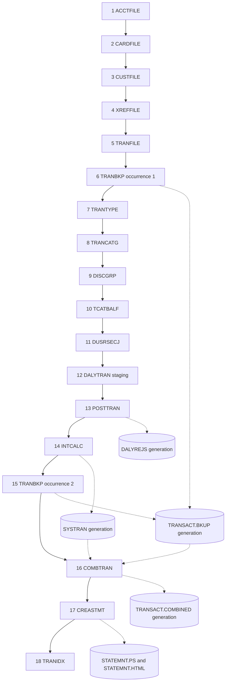

# CardDemo batch: job chain, cycles, GDG archives and reconciliation

This document is the reviewed design of the CardDemo batch layer: the legacy JCL jobs and their
Python replacements, the order they run in, how reruns and failures are handled, how generation
data groups (GDGs) are archived, and how outputs are reconciled with the COBOL rules. It is the
authority for every `batch/**` module: code that differs from it is a defect, and a later change
is made in this document first.

Table and column definitions are not restated here. They live in [data-model.md](data-model.md),
together with the numeric truncation rules every job applies.

Related documents:

- [data-model.md](data-model.md): COBOL-to-Python types, rounding, timestamps, the schema, the
    Alembic revisions and the seed counts.
- [architecture.md](architecture.md): layers and cross-cutting decisions, including identity and
    data masking.
- [traceability.md](traceability.md): each legacy artefact, its disposition and its target path.
- [README.md](README.md): install, configuration and run instructions.

Dataset names below omit the `AWS.M2.CARDDEMO.` prefix: `ACCTDATA.PS` is
`AWS.M2.CARDDEMO.ACCTDATA.PS`. Line numbers cite the legacy source files in this repository.

## Legacy job inventory

Each in-scope JCL job, its legacy steps, its inputs and outputs, and the Python module that
replaces it:

- **ACCTFILE** → `batch/loaders/acctfile.py`
    - Legacy steps: IDCAMS `STEP05` `DELETE`, `STEP10` `DEFINE CLUSTER` with `KEYS(11 0)`,
        `STEP15` `REPRO` (`jcl/ACCTFILE.jcl`).
    - Inputs → outputs: `ACCTDATA.PS` → `ACCTDATA.VSAM.KSDS`; target table `accounts.accounts`.
- **CARDFILE** → `batch/loaders/cardfile.py`
    - Legacy steps: SDSF close (`CLCIFIL`); IDCAMS `STEP05` delete cluster and AIX, `STEP10`
        define with `KEYS(16 0)`, `STEP15` `REPRO`; `STEP40` AIX `KEYS(11 16)`, `STEP50` path,
        `STEP60` `BLDINDEX`; SDSF open (`OPCIFIL`) (`jcl/CARDFILE.jcl`).
    - Inputs → outputs: `CARDDATA.PS` → `CARDDATA.VSAM.KSDS` and CARDAIX; target table
        `cards.cards`.
- **XREFFILE** → `batch/loaders/xreffile.py`
    - Legacy steps: IDCAMS `STEP05` delete cluster and AIX, `STEP10` define with `KEYS(16 0)`,
        `STEP15` `REPRO`; `STEP20` AIX `KEYS(11,25)`, `STEP25` path, `STEP30` `BLDINDEX`
        (`jcl/XREFFILE.jcl`).
    - Inputs → outputs: `CARDXREF.PS` → `CARDXREF.VSAM.KSDS` and CXACAIX; target table
        `xref.card_xref`.
- **CUSTFILE** → `batch/loaders/custfile.py`
    - Legacy steps: SDSF close; IDCAMS `STEP05` delete, `STEP10` define with `KEYS(9 0)`,
        `STEP15` `REPRO`; SDSF open (`jcl/CUSTFILE.jcl`).
    - Inputs → outputs: `CUSTDATA.PS` → `CUSTDATA.VSAM.KSDS`; target table `customers.customers`.
- **TRANFILE** → `batch/loaders/tranfile.py`
    - Legacy steps: SDSF close; IDCAMS `STEP05` delete cluster and AIX, `STEP10` define with
        `KEYS(16 0)`, `STEP15` `REPRO` of `DALYTRAN.PS.INIT`; `STEP20` AIX `KEYS(26 304)`,
        `STEP25` path, `STEP30` `BLDINDEX`; SDSF open (`jcl/TRANFILE.jcl`).
    - Inputs → outputs: one priming record → `TRANSACT.VSAM.KSDS`; target table
        `transactions.transactions`.
- **TRANBKP** → `batch/jobs/tranbkp.py`
    - Legacy steps: `STEP05R` REPROC unload; `STEP05` IDCAMS delete cluster and AIX; `STEP10`
        define with `KEYS(16 0)` and `COND=(4,LT)` (`jcl/TRANBKP.jcl`).
    - Inputs → outputs: TRANSACT → `TRANSACT.BKUP(+1)` (LRECL 350); TRANSACT is left empty.
- **TRANTYPE** → `batch/loaders/trantype.py`
    - Legacy steps: IDCAMS `STEP05` delete, `STEP10` define with `KEYS(2 0)`, `STEP15` `REPRO`
        (`jcl/TRANTYPE.jcl`).
    - Inputs → outputs: `TRANTYPE.PS` → `TRANTYPE.VSAM.KSDS`; target table
        `reference.transaction_types`.
- **TRANCATG** → `batch/loaders/trancatg.py`
    - Legacy steps: IDCAMS `STEP05` delete, `STEP10` define with `KEYS(6 0)`, `STEP15` `REPRO`
        (`jcl/TRANCATG.jcl`).
    - Inputs → outputs: `TRANCATG.PS` → `TRANCATG.VSAM.KSDS`; target table
        `reference.transaction_categories`.
- **DISCGRP** → `batch/loaders/discgrp.py`
    - Legacy steps: IDCAMS `STEP05` delete, `STEP10` define with `KEYS(16 0)`, `STEP15` `REPRO`
        (`jcl/DISCGRP.jcl`).
    - Inputs → outputs: `DISCGRP.PS` → `DISCGRP.VSAM.KSDS`; target table
        `disclosure.disclosure_groups`.
- **TCATBALF** → `batch/loaders/tcatbalf.py`
    - Legacy steps: IDCAMS `STEP05` delete, `STEP10` define with `KEYS(17 0)`, `STEP15` `REPRO`
        (`jcl/TCATBALF.jcl`).
    - Inputs → outputs: `TCATBALF.PS` → `TCATBALF.VSAM.KSDS`; target table
        `transactions.transaction_category_balances`.
- **DUSRSECJ** → `batch/loaders/security_init.py`
    - Legacy steps: `PREDEL` IEFBR14 delete; `STEP01` IEBGENER inline data → `USRSEC.PS`
        (LRECL 80); `STEP02` IDCAMS delete and define with `KEYS(8,0)`; `STEP03` `REPRO`
        (`jcl/DUSRSECJ.jcl`).
    - Inputs → outputs: `USRSEC.PS` → `USRSEC.VSAM.KSDS`; target table `security.users`.
- **DALYTRAN staging** (new; no JCL) → `batch/loaders/dalytran.py`
    - Replaces the legacy precondition that `DALYTRAN.PS` exists before POSTTRAN runs: the
        `DALYTRAN` DD of `jcl/POSTTRAN.jcl`, record layout `cpy/CVTRA06Y.cpy`.
    - Inputs → outputs: `DALYTRAN.PS` → target table `transactions.daily_transactions`.
- **POSTTRAN** → `batch/jobs/posttran.py`, with the posting rules in
    `backend/app/services/transactions/cbtrn02c.py`
    - Legacy steps: `STEP15` CBTRN02C (`jcl/POSTTRAN.jcl`).
    - Inputs → outputs: DALYTRAN, CARDXREF, ACCTDATA, TCATBALF → TRANSACT, ACCTDATA, TCATBALF,
        `DALYREJS(+1)` (RECFM F, LRECL 430).
- **INTCALC** → `batch/jobs/interest_calc.py`
    - Legacy steps: `STEP15` CBACT04C with `PARM='2022071800'` (`jcl/INTCALC.jcl`).
    - Inputs → outputs: TCATBALF, CARDXREF and its AIX path, ACCTDATA, DISCGRP → ACCTDATA,
        `SYSTRAN(+1)` (RECFM F, LRECL 350).
- **COMBTRAN** → `batch/jobs/combtran.py`
    - Legacy steps: `STEP05R` SORT of `TRANSACT.BKUP(0)` and `SYSTRAN(0)` by TRAN-ID; `STEP10`
        IDCAMS `REPRO` (`jcl/COMBTRAN.jcl`).
    - Inputs → outputs: `TRANSACT.BKUP(0)` and `SYSTRAN(0)` → `TRANSACT.COMBINED(+1)` and
        TRANSACT.
- **CREASTMT** → `batch/jobs/statement_gen/creastmt.py`, with `cbstm03a.py`, `cbstm03b.py` and
    `templates/statement.html.j2` in the same package
    - Legacy steps: `DELDEF01` IDCAMS delete and define of TRXFL with `KEYS(32 0)`; `STEP010` SORT
        `FIELDS=(263,16,CH,A,1,16,CH,A)` with an `OUTREC` that moves the card number first;
        `STEP020` `REPRO`; `STEP030` IEFBR14 delete of the old statements; `STEP040` CBSTM03A.
        `STEP020` to `STEP040` run with `COND=(0,NE)` (`jcl/CREASTMT.JCL`).
    - Inputs → outputs: TRANSACT, CARDXREF, ACCTDATA, CUSTDATA → `STATEMNT.PS` (LRECL 80) and
        `STATEMNT.HTML` (LRECL 100).
- **TRANIDX** → `batch/jobs/tranidx.py`
    - Legacy steps: IDCAMS `STEP20` AIX `KEYS(26 304)`, `STEP25` path, `STEP30` `BLDINDEX`
        (`jcl/TRANIDX.jcl`).
    - Inputs → outputs: TRANSACT → the TRANSACT AIX.

### Superseded and excluded artefacts

Legacy infrastructure whose effect a named target mechanism provides:

- **CLOSEFIL, OPENFIL** → the batch window ([Batch window](#batch-window)).
- **WAITSTEP, COBSWAIT, `asm/MVSWAIT.asm`, `maclib/ASMWAIT.mac`** → not needed: the sequential
    chain runner needs no timed wait.
- **DEFGDGB, DEFGDGD, DALYREJS (the GDG definition job), REPTFILE** →
    `batch/orchestration/gdg.py` and the `batch.gdg_generations` catalog
    ([GDG archives](#gdg-archives)).
- **`proc/REPROC.prc`, `ctl/REPROCT.ctl`** → the fixed-width writers in TRANBKP and COMBTRAN.
- **`scheduler/CardDemo.ca7`, `scheduler/CardDemo.controlm`** →
    `batch/orchestration/batch_chain.py`.
- **`jcl/TRANREPT.jcl`, `proc/TRANREPT.prc`** → the online report service
    (`backend/app/services/reports/`). There is no batch TRANREPT job.

Excluded: TRANEXTR and CBPAUP0J, which belong to the optional modules.

## Chain order

The chain follows the upstream CardDemo README "Running Batch Jobs" order, cross-checked against
`scheduler/CardDemo.controlm` and `scheduler/CardDemo.ca7`, with these adjustments:

- **Dropped.** TRANEXTR and CBPAUP0J (excluded modules), and CLOSEFIL, OPENFIL and WAITSTEP
    (superseded).
- **Inserted.** TRANFILE, which the README omits, goes before the first TRANBKP. Step 12,
    DALYTRAN, loads the staging table and replaces the legacy precondition that `DALYTRAN.PS`
    exists before POSTTRAN.
- **Swapped.** Two adjacent loader pairs: CUSTFILE before XREFFILE, and TRANTYPE before TRANCATG.
    The legacy loaders read nothing the others write, so the swap changes no output, and
    PostgreSQL foreign keys need parents first.

The 18 steps, with generation datasets and statement files as dotted edges:



`batch/orchestration/batch_chain.py` holds this order as `CHAIN`, an ordered tuple of
`ChainStep(stepNo, job, durability)`. `job` is a `JobDefinition(name, runner, aliases)`; both
TRANBKP occurrences share one definition. `RunChain(context, options)` applies the rules in
[Cycles and step identity](#cycles-and-step-identity) and [Exit statuses](#exit-statuses).

## Step table

Each chain step, the module that runs it, its durability and rerun class, and the exit statuses
it can return:

| Step | Job | Module | Durability and rerun class | Exit statuses |
|---|---|---|---|---|
| 1 | ACCTFILE | `batch/loaders/acctfile.py` | Atomic replace | 0, 12 |
| 2 | CARDFILE | `batch/loaders/cardfile.py` | Atomic replace | 0, 12 |
| 3 | CUSTFILE | `batch/loaders/custfile.py` | Atomic replace | 0, 12 |
| 4 | XREFFILE | `batch/loaders/xreffile.py` | Atomic replace | 0, 12 |
| 5 | TRANFILE | `batch/loaders/tranfile.py` | Atomic replace | 0, 12 |
| 6 | TRANBKP, occurrence 1 | `batch/jobs/tranbkp.py` | Atomic; not repeatable in a cycle | 0, 12 |
| 7 | TRANTYPE | `batch/loaders/trantype.py` | Atomic replace | 0, 12 |
| 8 | TRANCATG | `batch/loaders/trancatg.py` | Atomic replace | 0, 12 |
| 9 | DISCGRP | `batch/loaders/discgrp.py` | Atomic replace | 0, 12 |
| 10 | TCATBALF | `batch/loaders/tcatbalf.py` | Atomic replace | 0, 12 |
| 11 | DUSRSECJ | `batch/loaders/security_init.py` | Atomic replace | 0, 12 |
| 12 | DALYTRAN staging | `batch/loaders/dalytran.py` | Atomic replace | 0, 12 |
| 13 | POSTTRAN | `batch/jobs/posttran.py` | Per-write durability; not repeatable | 0, 4, 16 |
| 14 | INTCALC | `batch/jobs/interest_calc.py` | Per-write durability; not repeatable | 0, 16 |
| 15 | TRANBKP, occurrence 2 | `batch/jobs/tranbkp.py` | Atomic; not repeatable in a cycle | 0, 12 |
| 16 | COMBTRAN | `batch/jobs/combtran.py` | Atomic; not repeatable | 0, 12 |
| 17 | CREASTMT | `batch/jobs/statement_gen/creastmt.py` | Files only; overwrite | 0, 16 |
| 18 | TRANIDX | `batch/jobs/tranidx.py` | Same result on every run | 0, 12 |

A command can also exit 12 before any step runs, when it is refused, or after a producer step
has committed, when its generation cannot be published ([Exit statuses](#exit-statuses)).

### Steps 1–5 and 7–11: loaders

- **Modules.** ACCTFILE, CARDFILE, CUSTFILE, XREFFILE, TRANFILE, TRANTYPE, TRANCATG, DISCGRP and
    TCATBALF run `batch/loaders/<job>.py`, with the job name lower-cased. DUSRSECJ runs
    `batch/loaders/security_init.py`. All share the replace-load routine in
    `batch/loaders/replace_loader.py`.
- **Inputs → outputs.** The job's EBCDIC image (the default) or its ASCII image → its table.
    TRANFILE skips the priming record. DUSRSECJ bcrypt-hashes `SEC-USR-PWD`.
- **Durability and rerun class.** Atomic replace: `DELETE` plus insert in one transaction, with
    constraints deferred. Same result on every run.
- **Parameters.** `--encoding {ebcdic|ascii}` and `--source-dir`. TRANFILE and DUSRSECJ are
    EBCDIC only, as no ASCII copies of their images exist.
- **Exit status.** 0, or 12 when the image is missing or malformed.

The images each loader reads, from `CARDDEMO_EBCDIC_DIR` and `CARDDEMO_ASCII_DIR`:

| Step | Job | EBCDIC image | ASCII image |
|---|---|---|---|
| 1 | ACCTFILE | `AWS.M2.CARDDEMO.ACCTDATA.PS` | `acctdata.txt` |
| 2 | CARDFILE | `AWS.M2.CARDDEMO.CARDDATA.PS` | `carddata.txt` |
| 3 | CUSTFILE | `AWS.M2.CARDDEMO.CUSTDATA.PS` | `custdata.txt` |
| 4 | XREFFILE | `AWS.M2.CARDDEMO.CARDXREF.PS` | `cardxref.txt` |
| 5 | TRANFILE | `AWS.M2.CARDDEMO.DALYTRAN.PS.INIT` | None |
| 7 | TRANTYPE | `AWS.M2.CARDDEMO.TRANTYPE.PS` | `trantype.txt` |
| 8 | TRANCATG | `AWS.M2.CARDDEMO.TRANCATG.PS` | `trancatg.txt` |
| 9 | DISCGRP | `AWS.M2.CARDDEMO.DISCGRP.PS` | `discgrp.txt` |
| 10 | TCATBALF | `AWS.M2.CARDDEMO.TCATBALF.PS` | `tcatbal.txt` |
| 11 | DUSRSECJ | `AWS.M2.CARDDEMO.USRSEC.PS` | None |
| 12 | DALYTRAN | `AWS.M2.CARDDEMO.DALYTRAN.PS` | `dailytran.txt` |

`AWS.M2.CARDDEMO.ACCDATA.PS` is a byte-identical duplicate of `ACCTDATA.PS` and is ignored. Image
framing and decoding are in [data-model.md](data-model.md#loader-decoding).

### Step 12: DALYTRAN staging

- **Module.** `batch/loaders/dalytran.py`.
- **Inputs → outputs.** The daily image, by default
    `CARDDEMO_EBCDIC_DIR/AWS.M2.CARDDEMO.DALYTRAN.PS` → `transactions.daily_transactions`, one row
    per record with `record_seq` starting at 1.
- **Durability and rerun class.** Atomic replace.
- **Parameters.** `--daily-file`, `--encoding`.
- **Exit status.** 0 or 12.

### Steps 6 and 15: TRANBKP

- **Module.** `batch/jobs/tranbkp.py`, one definition for both occurrences.
- **Inputs → outputs.** `transactions` in `tran_id_sort` order → `TRANSACT.BKUP(+1)` (350-byte
    records); then `DELETE FROM transactions`, in the same transaction.
- **Durability and rerun class.** Atomic; not repeatable within a cycle.
- **Parameters.** None.
- **Exit status.** 0 or 12.

### Step 13: POSTTRAN

- **Module.** `batch/jobs/posttran.py`; the rules are in
    `backend/app/services/transactions/cbtrn02c.py`.
- **Inputs → outputs.** `daily_transactions` in `record_seq` order, plus the cross-reference,
    accounts and category balances → transactions, accounts, category balances and
    `DALYREJS(+1)` (430-byte records).
- **Durability and rerun class.** Per-write durability ([Write durability](#write-durability));
    not repeatable.
- **Parameters.** `--as-of`.
- **Exit status.** 0; 4 when any record is rejected (legacy RC 4); 16 on an I/O error or a
    duplicate key (legacy abend 999).

### Step 14: INTCALC

- **Module.** `batch/jobs/interest_calc.py`.
- **Inputs → outputs.** Category balances, accounts, the cross-reference and disclosure groups →
    accounts and `SYSTRAN(+1)` (350-byte records).
- **Durability and rerun class.** Per-write durability; not repeatable.
- **Parameters.** `--run-date` (10 characters; default `2022071800`, the legacy `PARM`) and
    `--as-of`.
- **Exit status.** 0; 16 when the `DEFAULT` disclosure group is missing or on an I/O error.

### Step 16: COMBTRAN

- **Module.** `batch/jobs/combtran.py`.
- **Inputs → outputs.** `TRANSACT.BKUP(0)` and `SYSTRAN(0)`, merged in `tran_id` EBCDIC order →
    `TRANSACT.COMBINED(+1)` plus inserts into `transactions`.
- **Durability and rerun class.** Atomic; not repeatable.
- **Parameters.** None.
- **Exit status.** 0, or 12 on a duplicate key, with full rollback. This replaces the legacy
    `REPRO` step.

### Step 17: CREASTMT

- **Module.** `batch/jobs/statement_gen/creastmt.py`, with `cbstm03a.py` (statement writer) and
    `cbstm03b.py` (data access).
- **Inputs → outputs.** Transactions ordered by `cards.cards.card_num_sort`, joined on `card_num`,
    then by `transactions.transactions.tran_id_sort`; the cross-reference ordered by
    `cards.cards.card_num_sort`, joined on `card_num`; customers; accounts →
    `statements/STATEMNT.PS` (80-column lines) and `statements/STATEMNT.HTML` (100-column lines)
    under `CARDDEMO_OUTPUT_DIR`.
- **Durability and rerun class.** Files only; each run overwrites them.
- **Parameters.** None.
- **Exit status.** 0; 16 when the statement table capacity is exceeded
    ([CREASTMT](#creastmt-statements)).

### Step 18: TRANIDX

- **Module.** `batch/jobs/tranidx.py`.
- **Inputs → outputs.** Ensures `ix_transactions_proc_ts` exists and is valid:
    `CREATE INDEX IF NOT EXISTS`, then `REINDEX`.
- **Durability and rerun class.** Same result on every run.
- **Parameters.** None.
- **Exit status.** 0 or 12.

## Exit statuses

Exit statuses replace JCL condition codes:

| Status | Meaning | Chain behaviour |
|---|---|---|
| 0 | Success | Continues |
| 4 | Warning: POSTTRAN rejected at least one record (legacy `RETURN-CODE` 4) | Continues |
| 12 | Refusal or recoverable failure | Stops |
| 16 | Abend | Stops |

Status 12 is returned when:

- a loader image is missing or malformed, including a timestamp in none of the four text forms
    ([data-model.md](data-model.md#timestamps));
- COMBTRAN meets a duplicate key;
- a rerun of a `FAILED` or `INTERRUPTED` per-write step is refused;
- a financial reload is refused ([Financial reloads](#financial-reloads));
- the `OPEN` cycle has a `LOST` generation ([Lost generations](#lost-generations));
- publishing a step's generation after the step has committed fails while renaming the file,
    updating the catalog row or applying retention ([Publication](#publication));
- publishing a step's generation after the step has committed finds it `LOST`
    ([Lost generations](#lost-generations));
- the batch window is not available ([Batch window](#batch-window));
- outside a step, the database cannot be reached (`DATABASE NOT AVAILABLE`), or it rejects a
    statement the command does not map itself, as an unmigrated database does
    (`DATABASE ERROR`, naming only the error classes and the SQLSTATE);
- `job` runs with no `OPEN` cycle;
- `run-all --start-at` names an unknown step, or a step after step 1 for a new cycle
    ([Resume](#resume));
- `load init-users` runs with `APP_ENV=production`.

Status 16 is returned when:

- POSTTRAN meets an I/O error or a duplicate key;
- INTCALC finds no `DEFAULT` disclosure group, or meets an I/O error;
- CREASTMT input exceeds the statement table capacity.

Chain rules:

- The chain continues after exit 0 or 4 and stops at 8 or above, as `COND=(4,LT)` does.
- `run-all` and `seed-all` exit with the highest status of the steps they ran.
- Every CLI command runs inside the batch window, which excludes online access to the CLOSEFIL
    files ([Batch window](#batch-window)).

## Cycles and step identity

`batch/orchestration/run_ledger.py` keeps the run ledger in `batch.cycles`, `batch.cycle_steps`
and `batch.job_runs`. Their columns are in [data-model.md](data-model.md#supporting-tables).

### Cycles

A cycle is one pass of the 18-step chain. These open one:

- the Alembic seed, recorded by revision `0008` with steps 1–5 and 7–12 `COMPLETED`;
- `seed-all`, which marks any `OPEN` cycle `ABANDONED`, opens a new one and runs steps 1–5 and
    7–12;
- `run-all --new-cycle`, which marks any `OPEN` cycle `ABANDONED` and runs steps 1–18;
- `run-all` when no cycle is `OPEN`.

A cycle becomes `COMPLETED` when step 18 completes. A new cycle always starts from the loaders, so
a second full pass reloads the data rather than reapplying financial effects.

### Step identity, state and history

- Step identity is (`cycle_id`, `step_no`). The two TRANBKP occurrences are steps 6 and 15, so
    they never mistake each other for a retry.
- `batch.cycle_steps` holds one row per identity, created when the cycle opens. It carries the
    authoritative `state` (`PENDING`, `COMPLETED`, `FAILED`, `INTERRUPTED`) and `last_run_id`.
- `batch.job_runs` is the history: one row per execution, with any number of rows per identity.
- Re-executing a completed step adds a history row and moves `last_run_id`. No uniqueness rule is
    involved.

Commit points:

- A run's `RUNNING` row commits before the step starts.
- The run's final status and its `cycle_steps` state commit together. For atomic steps this
    happens in the step's own transaction; for per-write steps (POSTTRAN, INTCALC), after the
    step's last write.
- `FAILED` commits in its own transaction after the failure. A failure to publish a generation
    after the step has committed is not a step failure: the run and step stay `COMPLETED`
    ([Publication](#publication)).
- A run left `RUNNING` by a dead process is reclassified at the next command, so failures and any
    partial per-write effects stay visible.

### Command start sequence

Every CLI command begins in this order, before it executes any step or loader:

1. Take the batch window ([Batch window](#batch-window)).
2. Classify interrupted runs ([Interrupted runs](#interrupted-runs)).
3. Reconcile the GDG catalog with `gdg.ReconcileCatalog()` ([Recovery](#recovery)).
4. Refuse with exit 12 if the `OPEN` cycle has a `LOST` generation, unless the command is
    `seed-all` or `run-all --new-cycle` ([Lost generations](#lost-generations)).
5. Apply the scheduling rules below: skip, resume, failure, force and the reload refusal.

### Interrupted runs

The batch window guarantees that no other batch process is alive, so every `job_runs` row still
`RUNNING` belongs to a process that died. It becomes `INTERRUPTED`, and its step is classified by
durability class:

- **Atomic steps** (loaders, TRANBKP, COMBTRAN, TRANIDX) and **files-only steps** (CREASTMT)
    committed nothing, because their transaction ended with the connection. Their `.part` file is
    removed by catalog recovery. The step returns to `PENDING`, and the next `run-all` retries it.
- **Per-write steps** (POSTTRAN, INTCALC) may have committed writes. The step becomes
    `INTERRUPTED` and is treated exactly like `FAILED` ([Failure](#failure)).

### Skip

A step whose state is `COMPLETED` is not executed again. A `SKIPPED` history row is recorded, and
the command exits 0. Retrying after success is therefore a no-op: a second TRANBKP 15 never writes
an empty newest BKUP generation, and COMBTRAN keeps resolving the right `(0)`.

### Resume

- `run-all` with an `OPEN` cycle runs, in order, every step not yet `COMPLETED` in it.
- `--start-at STEP` runs from that step on, skipping completed ones. `STEP` is a step number or a
    job name; for TRANBKP, the name means its first incomplete occurrence.
- `--start-at` resumes the `OPEN` cycle only. A new cycle, from `--new-cycle` or because no cycle
    is `OPEN`, always starts from the loaders at step 1 ([Cycles](#cycles)), so it accepts only
    `--start-at 1` or its job name. Any later step is refused before a cycle is abandoned or
    opened: the command changes nothing and exits 12 with the message below. The message is one
    line, with one space after the semicolon; the sample wraps it there:

```text
A NEW CYCLE STARTS AT STEP 1, NOT STEP STEP_NUMBER JCL_NAME;
--start-at RESUMES ONLY AN OPEN CYCLE
```

`STEP_NUMBER` and `JCL_NAME` are the start step's number and legacy JCL name, such as `13` and
`POSTTRAN`; for TRANBKP the start step is step 6. An unknown `STEP` exits 12 with
`UNKNOWN STEP: STEP` before any cycle changes.

### Failure

- A `FAILED` atomic step has rolled back completely, and the next `run-all` retries it.
- A `FAILED` or `INTERRUPTED` per-write step keeps its partial effects, as the legacy abend does.
    `run-all` and `job` refuse to rerun it: they exit 12 naming the cycle and step, and the two
    recovery paths:
    - `seed-all` or `run-all --new-cycle`, to restore from the loaders;
    - `--force`, which reruns from the partial state as a legacy restart would.

### Force

`--force` executes the start step whatever its state, `COMPLETED` included, and is never applied
implicitly. It adds a history row, and on success sets the step `COMPLETED` with `last_run_id`
pointing to the new run. It never overrides the [financial-reload refusal](#financial-reloads).

### Standalone commands

- `job JOB_NAME` runs that job as its step in the `OPEN` cycle, with the same skip, failure and
    force rules. For TRANBKP it runs the first incomplete occurrence, or the one named by
    `--occurrence {1|2}`. With no `OPEN` cycle, it exits 12.
- `load LOADER_NAME` executes, because a replace-load produces the same state every time, unless
    the [financial-reload rule](#financial-reloads) refuses it:
    - With an `OPEN` cycle, it adds a history row against its step and sets the step `COMPLETED`,
        with `last_run_id` pointing to the new run. A loader run right after the Alembic seed, or
        a repeated loader, therefore succeeds.
    - Without an `OPEN` cycle, the history row has no cycle.
    - It never opens, closes or abandons a cycle.

`JOB_NAME` and `LOADER_NAME` are the command names listed in [CLI usage](#cli-usage).

### Financial reloads

Three loaders, ACCTFILE, TCATBALF and TRANFILE, replace tables that later steps write:

| `load` name | Table | Later steps that write it |
|---|---|---|
| `accounts` | `accounts.accounts` | 13 POSTTRAN, 14 INTCALC |
| `tran-cat-balances` | `transactions.transaction_category_balances` | 13 POSTTRAN |
| `transactions` | `transactions.transactions` | 6 and 15 TRANBKP, 13 POSTTRAN, 16 COMBTRAN |

While any of those later steps in the `OPEN` cycle is `COMPLETED`, `FAILED` or `INTERRUPTED`, the
load changes nothing and exits 12 with the message below. The message is one line, with one
space after the semicolon; the sample wraps it there:

```text
RELOAD REFUSED: TABLE_NAME WAS CHANGED BY STEPS STEP_NUMBERS OF CYCLE CYCLE_ID;
RUN seed-all OR run-all --new-cycle
```

`TABLE_NAME` is the schema-qualified table from the table above, such as `accounts.accounts`.
`STEP_NUMBERS` lists the table's later steps that are in one of those states, in ascending order
and separated by commas without spaces, such as `13,14`. `CYCLE_ID` is the `OPEN` cycle's
`cycle_id`. The refusal applies whichever command runs the loader: `load`, or `run-all` when it
reaches the loader's step, `--start-at` with `--force` included. `--force` does not override the
refusal. Reloading would otherwise restore seed balances while the cycle still records posting as
done, leaving posted transactions whose balance effects had vanished.

All other loads execute in any state, because no later step writes their tables: users, cards,
customers, the cross-reference, transaction types and categories, disclosure groups, and the
daily file.

## GDG archives

`batch/orchestration/gdg.py` replaces the four generation data groups the chain writes. Each
generation is a file of fixed-width records in the legacy layout (`record_layouts.EncodeRecord`),
with zoned signed fields and one record per line terminated by `\n`.

| Base | LRECL | Producer | Read by | LISTCAT attribute |
|---|---|---|---|---|
| TRANSACT.BKUP | 350 | TRANBKP, steps 6 and 15 | COMBTRAN `(0)` | `NOSCRATCH` (line 1637) |
| DALYREJS | 430 | POSTTRAN, step 13 | None | `SCRATCH` (line 690) |
| SYSTRAN | 350 | INTCALC, step 14 | COMBTRAN `(0)` | `SCRATCH` (line 1106) |
| TRANSACT.COMBINED | 350 | COMBTRAN, step 16 | None | `SCRATCH` (line 2925) |

Every base has `LIMIT 5` in `catlg/LISTCAT.txt`. Files live at
`CARDDEMO_OUTPUT_DIR/gdg/<BASE>/G####V00.dat`, where `<BASE>` is the base name above and `####`
is the generation number. The catalog is `batch.gdg_generations`
([data-model.md](data-model.md#supporting-tables)).

### Publication

Publishing a generation takes these steps:

1. The job writes `G####V00.dat.part` and fsyncs it.
2. The catalog row is committed as `COMMITTED`, with the file's SHA-256, as the job's final
    database write.
3. The file is renamed to its final name.
4. The row is set to `PUBLISHED`.

Generation references `(0)` and `(-n)` count only `PUBLISHED` rows.

The four producer jobs (TRANBKP, POSTTRAN, INTCALC and COMBTRAN) take steps 1 and 2: the
`COMMITTED` row commits in the transaction that records the run `COMPLETED`. They never publish.
Once the step has committed, `batch_chain.FinishStep` takes steps 3 and 4 and applies retention,
once per step, through `gdg.PublishRunGenerations`. A failure there cannot undo the committed
step, so its run and step stay `COMPLETED`:

- When renaming the file, updating the catalog row or applying retention fails with a file or
    database error, the chain stops with exit 12. The next command's `gdg.ReconcileCatalog()`
    completes the publication ([Recovery](#recovery)), and `run-all` then skips the completed
    step and resumes at the next one.
- When neither the final file nor its `.part` file matches the catalog hash, the row becomes
    `LOST`. The chain stops with exit 12 naming the generation, and the cycle is not completed
    ([Lost generations](#lost-generations)).

The module's interface:

- `NewGeneration(context, base, connection=None)`: a context manager that yields the writer of
    a new `(+1)` generation of `base` and writes its `.part` file. On a normal exit it fsyncs the
    file and inserts the `COMMITTED` row; an exception inside the block deletes the `.part` file
    and catalogs nothing. `connection` decides when the row commits and who publishes it:
    - With the caller's `connection`, the row joins the caller's transaction and stays
        `COMMITTED` until `PublishRunGenerations` runs after that transaction commits. Every chain
        producer passes its connection, and `batch_chain.FinishStep` calls
        `PublishRunGenerations`.
    - Without a connection, the row commits in a transaction of its own, and the generation is
        published, and retention applied, as soon as the block exits.
- `PublishRunGenerations(context)`: takes steps 3 and 4 for every `COMMITTED` generation of the
    context's run, marking a row `LOST` when no file matches its hash, then applies retention to
    each base that gained a generation. With no started run it does nothing.
- `ResolveGeneration(context, base, relative=0)`: resolves `(0)`, the default, or `(-n)`,
    counting `PUBLISHED` rows only. It refuses a base with a `LOST` row in the `OPEN` cycle.
- `RollOff(context, base, limit=GDG_LIMIT)`: applies retention, rolling off every `PUBLISHED`
    generation older than the newest `limit`. `GDG_LIMIT` is 5, the `LIMIT 5` above.
- `ReconcileCatalog(context)`: completes or condemns interrupted publications, then completes
    interrupted retention for every base.

`context` is the command's `JobContext` (`batch/orchestration/job_context.py`): the job engine,
the settings, the clock and the run's identity. `base` is a `GdgBase`, one of `gdg.TRANSACT_BKUP`,
`gdg.DALYREJS`, `gdg.SYSTRAN` and `gdg.TRANSACT_COMBINED`. Its `name`, `lrecl` and `scratch`
fields hold the base name, its LRECL and its LISTCAT attribute, so the record length travels with
the base and no call takes it separately.

### Recovery

`gdg.ReconcileCatalog()` runs at the start of every CLI command, under the batch window, after
interrupted runs are classified and before any resolution, skip or retention:

- a `COMMITTED` row whose final file exists with the right hash becomes `PUBLISHED`;
- a `COMMITTED` row whose `.part` file exists with the right hash has the file renamed, then
    becomes `PUBLISHED`;
- any other `COMMITTED` row becomes `LOST`;
- a `.part` file with no catalog row, left by a crash before commit, is deleted;
- `LIMIT 5` retention ([Retention](#retention-and-the-scratch-conflict)) is applied to every
    base, whether or not it gained a generation in this call;
- the final file of a `ROLLED_OFF` generation of a `SCRATCH` base is deleted. TRANSACT.BKUP
    files are kept.

An interruption between publication and retention, or between `ROLLED_OFF` and the deletion of
the file, is therefore completed by the next command. Each step finds nothing to do once the
catalog is consistent, so running it again changes nothing.

A publication that failed after its step committed ([Publication](#publication)) leaves a
`COMMITTED` row or an unfinished retention. The next command completes it the same way, before it
schedules any step, and `run-all` then skips the `COMPLETED` step.

### Lost generations

- While the `OPEN` cycle has any `LOST` generation, every command exits 12 naming it before
    executing anything. This covers `run-all` (resume or `--start-at`), `job`, `load` and
    `--force`.
- A generation found `LOST` while the chain publishes a committed step's generations
    ([Publication](#publication)) stops the chain at once with exit 12 naming it. The step stays
    `COMPLETED`, and the cycle is not completed: it stays blocked until `seed-all` or
    `run-all --new-cycle`.
- The block exists because the producer's effects cannot be repeated. TRANBKP has already deleted
    the archived rows; POSTTRAN, INTCALC and COMBTRAN have already written their effects. A skip,
    or a `(0)` resolution, would also silently use an older generation.
- Only `seed-all` and `run-all --new-cycle` proceed. They mark the cycle `ABANDONED` and its
    `LOST` rows `ABANDONED`, then restart from the loaders, whose new cycle produces every
    generation it later resolves.

### Abnormal disposition

DALYREJS and SYSTRAN are `DISP=(NEW,CATLG,DELETE)` (`jcl/POSTTRAN.jcl` lines 34–38;
`jcl/INTCALC.jcl` lines 37–41). When POSTTRAN or INTCALC fails, its `.part` file is deleted and no
generation is cataloged.

### Retention and the SCRATCH conflict

The inputs disagree about TRANSACT.BKUP. `catlg/LISTCAT.txt` records it as `NOSCRATCH` (line
1637), while `jcl/DEFGDGB.jcl` defines it `SCRATCH` (lines 24–27). The catalog is the authority:
DEFGDGB treats an existing base as success (`IF LASTCC=12 THEN SET MAXCC=0`), so running it never
changes the attribute the catalog shows in effect.

When a sixth generation is published, the oldest `PUBLISHED` one is rolled off:

- for the `SCRATCH` bases (DALYREJS, SYSTRAN, TRANSACT.COMBINED), the file is deleted and the row
    becomes `ROLLED_OFF`;
- for TRANSACT.BKUP (`NOSCRATCH`), the row becomes `ROLLED_OFF`, so the generation is no longer
    resolvable, and the file is kept.

The `ROLLED_OFF` state commits before a `SCRATCH` file is deleted, so an interruption never
leaves a resolvable generation without its file. `gdg.ReconcileCatalog()` completes retention
([Recovery](#recovery)): after a crash once a sixth generation is published, or before a
rolled-off file is deleted, the next command rolls off and deletes what remains. TRANSACT.BKUP
files are still kept.

## Batch window

The batch window replaces CLOSEFIL and OPENFIL (`jcl/CLOSEFIL.jcl`, `jcl/OPENFIL.jcl`). Both
online code and batch observe it.

### Legacy effect

CLOSEFIL issues `CEMT SET FIL(...) CLO` for `TRANSACT`, `CCXREF`, `ACCTDAT`, `CXACAIX` and
`USRSEC`. A closed file is also UNENABLED, so CICS does not reopen it implicitly. Any online
`READ`, `STARTBR`, `WRITE` or `REWRITE` on it returns `NOTOPEN` (RESP 19, RESP2 60) until OPENFIL
runs, and each program takes the `WHEN OTHER` branch it has for that file. `CARDDAT`, `CARDAIX`
and `CUSTDAT` stay open.

### Batch side

`batch/orchestration/batch_window.py` provides `BatchWindow`, a context manager that
`batch/cli.py` enters around every command:

- It opens one dedicated psycopg2 connection in autocommit mode, separate from every job
    connection, and sets `lock_timeout = '60s'`.
- It takes `pg_advisory_lock(BATCH_WINDOW_LOCK)`, a session-level exclusive lock whose key comes
    from `backend/app/core/locks.py`.
- It holds that connection idle for the whole command: `run-all` (every step it runs, plus
    `gdg.ReconcileCatalog()`), `seed-all`, and each standalone `job` and `load`. Standalone
    commands take the window too, because the legacy operating sequence runs CLOSEFIL before any
    job that updates these files.
- Its `finally` runs `pg_advisory_unlock` and closes the connection. If the process dies,
    PostgreSQL releases the lock when the connection drops, so a crashed run never leaves the
    window closed.
- When the lock is not granted within 60 s, because another batch command holds it or an online
    request does not finish, the command changes nothing and exits 12 with this message:

    ```text
    BATCH WINDOW NOT AVAILABLE
    ```

Batch code never calls `EnterOnlineWindow`, because its job connections would conflict with its
own window. Alembic migrations do not take the window; they run with the backend stopped.

### Online side

The repositories for `WINDOW_TABLES` (`transactions.transactions`, `xref.card_xref` for the
`CCXREF` and `CXACAIX` paths, `accounts.accounts` and `security.users`) call
`locks.EnterOnlineWindow(request, fileName)` before their first statement in a request.
`request` is the FastAPI request, and `fileName` is the legacy CICS file the statement addresses
(`TRANSACT`, `CCXREF`, `CXACAIX`, `ACCTDAT` or `USRSEC`), which a refusal names:

- On the first call, it checks out one connection for the request and runs
    `SELECT pg_try_advisory_lock_shared(BATCH_WINDOW_LOCK)`; later calls reuse a granted or
    refused outcome without a query. A granted lock is held for the whole request and released by
    `locks.LeaveOnlineWindow(request)` in the request dependency's `finally`.
- When the lock is refused, `EnterOnlineWindow` raises `FileNotOpenError(fileName)` (RESP 19,
    RESP2 60) through the repository, so each service reaches the `WHEN OTHER` branch of the
    program it ports, with that program's literal.
- A shared request that would queue behind a waiting batch request is refused at once. New online
    access fails while the window is closing, and in-flight requests finish, as a CEMT close waits
    for current users.

The literal each transaction returns during the window, from the first window file it touches:

| Transaction | First window access | Literal |
|---|---|---|
| CC00 | `USRSEC` read | `Unable to verify the User ...` |
| CAVW, CAUP fetch | `CXACAIX` read | The `WS-FILE-ERROR-MESSAGE` text below |
| CAUP save | `ACCTDAT` `READ UPDATE` | `Could not lock account record for update` |
| CT00 | `TRANSACT` browse | `Unable to lookup transaction...` |
| CT01 | `TRANSACT` read | `Unable to lookup Transaction...` |
| CT02, account entered | `CXACAIX` read | `Unable to lookup Acct in XREF AIX file...` |
| CT02, card entered | `CCXREF` read | `Unable to lookup Card # in XREF file...` |
| CB00 | `ACCTDAT` read | `Unable to lookup Account...` |
| CU00, CU02 and CU03 fetch | `USRSEC` read | `Unable to lookup User...` |
| CU01 | `USRSEC` write | `Unable to Add User...` |
| CU02 update, CU03 delete | `USRSEC` `READ UPDATE` | `Unable to Update User...` |
| CM00, CA00, CCLI, CCDL, CCUP, CR00 | None | Unaffected: they touch no window file |

The CAVW and CAUP fetch literal, with its fixed-width fields and trailing blanks trimmed
(`cbl/COACTVWC.cbl` lines 86–105, 755–766; `cbl/COACTUPC.cbl` lines 3685–3693):

```text
File Error: READ     on CXACAIX   returned RESP 000000019 ,RESP2 000000060
```

CR00 is not gated: the legacy program only wrote a TDQ job request and never opened `TRANSACT`.
Its ported report reads committed rows, and TRANBKP's single transaction means a report never
sees a half-archived table.

## Write durability

Every CardDemo file is defined `RECOVERY(NONE)` (`csd/CARDDEMO.CSD` lines 9, 21, 33, 46, 59, 72,
84, 96). Each completed VSAM write therefore survives later failures in the same task. The batch
steps keep this by durability class:

- **COBOL-program steps** (POSTTRAN, INTCALC). Each write commits as it is made. An abend leaves
    the earlier writes in place, and the step's `DISP=(NEW,CATLG,DELETE)` output generation is
    discarded ([Abnormal disposition](#abnormal-disposition)). The step is not rerun without
    `--force` or a new cycle ([Failure](#failure)).
- **Utility steps** (loaders, TRANBKP, COMBTRAN, TRANIDX). These are atomic and fully rolled back
    on failure. They reproduce the success effect of IDCAMS `DELETE`, `DEFINE` and `REPRO`,
    DFSORT and IEBGENER; their failure paths belong to the IBM utilities, not to CardDemo source.
- **Files-only step** (CREASTMT). It writes no table; its statement files are overwritten on each
    run.

Batch row updates take `FOR UPDATE` on account and category-balance rows, in addition to the
window, so there are no lost updates and no lost inserts.

## Per-job semantics

### POSTTRAN: posting

From `cbl/CBTRN02C.cbl` lines 190–231 and 365–600. For each staged record, in `record_seq` order:

1. Look up the cross-reference by card number. If it is missing, reject with reason 100,
    `INVALID CARD NUMBER FOUND`.
2. Read the account. If it is missing, reject with reason 101, `ACCOUNT RECORD NOT FOUND`.
3. Compute `tempBal` = cycle credit − cycle debit + amount. If `creditLimit < tempBal`, set
    reason 102, `OVERLIMIT TRANSACTION`.
4. If the account `expiration_date` is before the date of `orig_ts`, set reason 103,
    `TRANSACTION RECEIVED AFTER ACCT EXPIRATION`. It overwrites a 102.
5. A rejected record is written to `DALYREJS(+1)` as the 350-byte record plus an 80-byte trailer:
    the reason `9(04)` and its description `X(76)`.
6. Otherwise, create or update the category balance, then update the account (the amount is
    added to the balance, and to cycle credit when it is ≥ 0, else to cycle debit), then insert
    the transaction. `orig_ts` is copied from the staged record (line 436); `proc_ts` is the clock
    in format `D`.

Further rules:

- The 109 path, an account rewrite that finds no record, is kept: the transaction is still
    written, and the record is not counted as a reject (lines 545–559).
- The run displays `TRANSACTIONS PROCESSED :` and `TRANSACTIONS REJECTED  :` with the two counts
    (lines 227–228), and exits 4 when any record was rejected (line 230).
- An abend mid-file leaves the earlier records posted (lines 710–711).
- The truncation of each `ADD` and `COMPUTE` is in
    [data-model.md](data-model.md#arithmetic-statements-and-numeric-moves).

### INTCALC: interest calculation

From `cbl/CBACT04C.cbl` lines 180–520:

- Read category balances in key order. On each change of account after the first,
    `1050-UPDATE-ACCOUNT` rewrites the previous account: it adds the total interest to the
    balance and zeros both cycle fields. The new account is then read, together with its first
    cross-reference card in `card_num` order, which is the AIX prime-key order.
- Look up the disclosure group by (`group_id`, type, category). When it is not found, retry with
    `DEFAULT`; when that is also missing, abend with exit 16.
- Skip records whose rate is 0. Otherwise compute the monthly interest,
    `(TRAN-CAT-BAL * DIS-INT-RATE) / 1200`, and write a SYSTRAN record:
    - `tran_id` = PARM-DATE followed by a 6-digit suffix that wraps from 999999 to 000000;
    - type `01`, category `05`, source `System`;
    - description `Int. for a/c ` followed by ACCT-ID;
    - merchant ID 0 and blank merchant fields;
    - the cross-reference card;
    - `orig_ts` and `proc_ts` = the clock, in format `D`.
- **The final account is never rewritten.** The loop tests end of file before the `READ` that
    sets it. When that `READ` hits end of file, the inner `IF` skips processing and
    `PERFORM UNTIL` ends, so the outer `ELSE` that would flush the last account is never reached
    (lines 187–221, 325–347):
    - the last account's SYSTRAN records are still written, but its balance and cycle fields stay
        unchanged;
    - an empty category-balance file performs no rewrite and ends with exit 0;
    - a single-account file rewrites nothing.
- `1400-COMPUTE-FEES` stays a no-op stub (lines 518–519).
- The fixed `PARM` gives every run the same ID prefix. Step identity prevents a second unforced
    run in a cycle.
- INTCALC opens the category balances for input only and never updates them.
- The truncation rules are in
    [data-model.md](data-model.md#arithmetic-statements-and-numeric-moves).

### CREASTMT: statements

From `jcl/CREASTMT.JCL` and `cbl/CBSTM03A.CBL`:

- The `STEP010` sort and `OUTREC` re-key become one ordered query. CBSTM03B's file access becomes
    `cbstm03b.py` queries.
- CBSTM03A's TIOT control-block walk is replaced by one log line listing the configured inputs.
    The `ALTER` and `GO TO` dispatch becomes direct calls.
- One statement is written per cross-reference record, in card order.

`STATEMNT.PS` has 80-column lines (`cbl/CBSTM03A.CBL` lines 86–146):

- `ST-LINE0`: asterisks around `START OF STATEMENT`.
- The name, built from the first, middle and last name, each taken up to its first space.
- Address lines 1–3.
- The `Basic Details` block: `Account ID         :`, `Current Balance    :` in `9(9).99-`, and
    `FICO Score         :`.
- `TRANSACTION SUMMARY`, with the headings `Tran ID`, `Tran Details` and `  Tran Amount`.
- One line per transaction: the ID, the description (49 characters), `$` and the amount in
    `Z(9).99-`.
- `Total EXP:` with `$` and the total in `Z(9).99-`, then the `END OF STATEMENT` asterisk line.

`STATEMNT.HTML` has 100-column lines reproducing the `HTML-L01` to `HTML-L80` literals and field
lines (`cbl/CBSTM03A.CBL` lines 148–223):

- They are rendered by `batch/jobs/statement_gen/templates/statement.html.j2` and padded to 100.
- Jinja2 runs with `autoescape=False` and a `finalize` hook that escapes only `&`, `<` and `>` in
    field values.
- Default autoescaping would also rewrite the apostrophes in the sample customer and transaction
    text, breaking byte parity with CBSTM03A's raw output. The three escaped characters never
    occur in the sample data, so parity holds, and a description typed online cannot inject
    markup.

Capacity:

- CBSTM03A loads transactions into a 51-card × 10-transaction table with no bounds check
    (`cbl/CBSTM03A.CBL` lines 225–232 and 758–850), so larger input overlays storage.
- The port processes up to 51 cards and up to 10 transactions per card exactly. Beyond that, the
    job exits 16 before writing any statement. The sample data peaks at 50 cards and 6
    transactions per card.

The statement PDF is not produced, because TXT2PDF1 is out of scope. The files stay under
`CARDDEMO_OUTPUT_DIR/statements/` and are not served online.

### TRANBKP, COMBTRAN and TRANIDX

- **TRANBKP** writes every transaction, in `tran_id_sort` order, to a new TRANSACT.BKUP generation
    and deletes them in the same transaction. Occurrence 1 of a freshly seeded cycle writes an
    empty generation, because the table holds no transactions yet.
- **COMBTRAN** merges `TRANSACT.BKUP(0)` and `SYSTRAN(0)` in `tran_id` EBCDIC order into a new
    TRANSACT.COMBINED generation and inserts the merged records into `transactions`, all in one
    transaction. A duplicate key rolls everything back with exit 12.
- **TRANIDX** makes sure `ix_transactions_proc_ts`, which replaces the AIX `KEYS(26 304)`, exists
    and is valid, with the same result on every run.

### Loaders

- Each loader replaces its table atomically from its image, with the same result on every run.
- **TRANFILE** applies the priming check before any typed decoding: a record whose first 342
    bytes are `X'00'` (bytes 342–349 read `00000100`) is skipped and counted. The TRANFILE image
    holds only that record, so the load gives 0 rows and 1 skipped record.
- **DUSRSECJ** bcrypt-hashes each password as it is read; plaintext is never stored.
    `load init-users` exits 12 with a refusal message when `APP_ENV=production`, so the sample
    users never reach a production database.
- **DALYTRAN** stages the daily file. POSTTRAN never updates or deletes staged rows, as the
    legacy daily file is input only.

## CLI usage

`batch/cli.py` defines the Typer app `APP`, installed as the console script `carddemo-batch` by
the editable `carddemo-batch` package. The examples run from the repository root.

To list the command groups:

```bash
.venv/bin/carddemo-batch --help
```

The help lists four command groups: `run-all`, `seed-all`, `job` and `load`.

The same CLI runs as a module:

```bash
.venv/bin/python -m batch.cli --help
```

### Run the chain

To run the chain, or to resume the `OPEN` cycle:

```bash
.venv/bin/carddemo-batch run-all
```

The `run-all` syntax, with optional arguments in square brackets:

```text
.venv/bin/carddemo-batch run-all [--new-cycle] [--start-at STEP] [--force]
```

Replace `STEP` with a chain step number from 1 to 18, or with a job name such as `POSTTRAN` or
`post-tran`. For TRANBKP, the name means its first incomplete occurrence.

To freeze the clock and run the rest of the chain from POSTTRAN, as the end-to-end test does:

```bash
.venv/bin/carddemo-batch run-all --start-at POSTTRAN \
    --as-of 2022-07-18T00:00:00
```

### Reload in a new cycle

To abandon any `OPEN` cycle and run the loaders of steps 1–5 and 7–12 in a new cycle:

```bash
.venv/bin/carddemo-batch seed-all
```

`seed-all` is destructive to the configured database: it replaces every loaded table.

### Run one job

To run one job as its step in the `OPEN` cycle, here POSTTRAN:

```bash
.venv/bin/carddemo-batch job post-tran
```

The `job` syntax, with optional arguments in square brackets and alternative values in braces,
separated by `|`:

```text
.venv/bin/carddemo-batch job JOB_NAME [--occurrence {1|2}] [--force]
```

Replace `JOB_NAME` with a name from this table. Each legacy JCL name is accepted as an alias.
`--occurrence` applies to `tran-backup` only.

| `JOB_NAME` | Legacy alias | Step |
|---|---|---|
| `post-tran` | `POSTTRAN` | 13 |
| `interest-calc` | `INTCALC` | 14 |
| `tran-backup` | `TRANBKP` | 6 and 15 |
| `comb-tran` | `COMBTRAN` | 16 |
| `statement-gen` | `CREASTMT` | 17 |
| `tran-index` | `TRANIDX` | 18 |

To run step 6, the first TRANBKP occurrence, whatever its state, `COMPLETED` included:

```bash
.venv/bin/carddemo-batch job tran-backup --occurrence 1 --force
```

Each TRANBKP run archives `transactions` to a new `TRANSACT.BKUP` generation, then empties the
table.

### Run one loader

To run one loader:

```bash
.venv/bin/carddemo-batch load LOADER_NAME
```

Replace `LOADER_NAME` with a name from this table. Each legacy JCL name is accepted as an alias.

| `LOADER_NAME` | Legacy alias | Step | Financial reload |
|---|---|---|---|
| `accounts` | `ACCTFILE` | 1 | Yes |
| `cards` | `CARDFILE` | 2 | No |
| `customers` | `CUSTFILE` | 3 | No |
| `card-xref` | `XREFFILE` | 4 | No |
| `transactions` | `TRANFILE` | 5 | Yes |
| `tran-types` | `TRANTYPE` | 7 | No |
| `tran-categories` | `TRANCATG` | 8 | No |
| `disclosure-groups` | `DISCGRP` | 9 | No |
| `tran-cat-balances` | `TCATBALF` | 10 | Yes |
| `init-users` | `DUSRSECJ` | 11 | No |
| `daily-transactions` | `DALYTRAN` | 12 | No |

A financial reload is refused while later steps of the `OPEN` cycle have written its table,
whether `load` or `run-all` runs it ([Financial reloads](#financial-reloads)).

To load the accounts from the ASCII image instead of the EBCDIC one:

```bash
.venv/bin/carddemo-batch load accounts --encoding ascii
```

### Run in a container

To run the chain inside the backend container of the Compose `full` profile:

```bash
docker compose --profile full run --rm backend carddemo-batch run-all
```

### Options

Each option configures the commands or steps named:

| Option | Applies to | Meaning |
|---|---|---|
| `--new-cycle` | `run-all` | Abandon any `OPEN` cycle and run steps 1–18 in a new cycle |
| `--start-at STEP` | `run-all` | Resume the `OPEN` cycle from `STEP`, skipping completed steps |
| `--force` | `run-all`, `job` | Execute the start step whatever its state |
| `--occurrence` | `job tran-backup` | `1` for step 6, `2` for step 15 |
| `--run-date DATE` | INTCALC, step 14 | The 10-character `PARM-DATE`; default `2022071800` |
| `--as-of TIMESTAMP` | POSTTRAN, INTCALC | The value `Clock.Now()` returns |
| `--daily-file PATH` | DALYTRAN, step 12 | The daily image to stage |
| `--encoding` | Loaders, DALYTRAN | `ebcdic` (the default) or `ascii` |
| `--source-dir DIRECTORY` | Loaders | The directory holding the images |

`DATE` is a 10-character text such as `2022071800`. `TIMESTAMP` is an ISO timestamp such as
`2022-07-18T00:00:00`. `PATH` and `DIRECTORY` are file-system paths; a relative one is resolved
against the repository root. The default daily image is
`CARDDEMO_EBCDIC_DIR/AWS.M2.CARDDEMO.DALYTRAN.PS`.

`--start-at` resumes only an `OPEN` cycle. A new cycle, from `--new-cycle` or because no cycle is
`OPEN`, always starts at step 1, so a later `STEP` exits 12 and changes nothing
([Resume](#resume)).

### Configuration

`batch.config.BatchSettings` reads these variables, so batch runs without `SECRET_KEY`:

| Variable | Default | Use |
|---|---|---|
| `APP_ENV` | `local` | `production` makes `load init-users` exit 12 |
| `SYNC_DATABASE_URL` | None | The psycopg2 connection URL |
| `BCRYPT_ROUNDS` | `12` | The bcrypt cost DUSRSECJ hashes passwords with |
| `CARDDEMO_EBCDIC_DIR` | `data/EBCDIC` | The EBCDIC images |
| `CARDDEMO_ASCII_DIR` | `data/ASCII` | The ASCII images |
| `CARDDEMO_OUTPUT_DIR` | `var/batch-output` | GDG archives and statements; git-ignored |

Resolution rules, from `backend/app/core/paths.py`:

- The settings file is `backend/.env` (`ENV_FILE`), and process environment variables override
    it. When the file is absent, as in containers, the environment alone applies.
- `ResolveRepoPath` returns an absolute value unchanged and resolves a relative one against the
    repository root, never against the working directory. The three directory variables,
    `--source-dir` and `--daily-file` all pass through it, so the CLI gives the same result from
    any directory.

Identity and time:

- Batch runs as the operating-system account that starts `carddemo-batch`, connecting with the
    `SYNC_DATABASE_URL` credentials. There is no application user, and only command parameters
    are read as input.
- `Clock.Now()` in `batch/orchestration/clock.py` returns local time, or the `--as-of` value, so
    reconciliation runs are deterministic. It is truncated to hundredths of a second.
- `JobContext` in `batch/orchestration/job_context.py` carries the session, settings, clock, and
    cycle and run IDs to every job and loader.

Batch reaches backend code only by Python import of the editable `carddemo-backend` package,
never over HTTP: `app.utils`, `app.models`, `app.seed.image_reader`,
`app.services.transactions.cbtrn02c`, `app.core.security.HashPassword`, `app.core.paths`,
`app.core.locks` (lock keys only) and `app.core.logging`. Jobs issue SQLAlchemy Core statements
over the sync engine in `batch/db.py`; they never use the async repositories.

### Recovery recipes

To retry a failed atomic step, rerun the chain; it resumes at the first step not yet `COMPLETED`:

```bash
.venv/bin/carddemo-batch run-all
```

The same command finishes a publication that failed after its step committed: the catalog is
reconciled first ([Recovery](#recovery)), and the committed step is skipped.

To recover from a failed or interrupted per-write step (POSTTRAN or INTCALC) by restoring from the
loaders in a new cycle:

```bash
.venv/bin/carddemo-batch run-all --new-cycle
```

`seed-all` restores the loaded tables the same way, without running steps 13–18.

To continue instead from the partial state, as a legacy restart would:

```bash
.venv/bin/carddemo-batch run-all --start-at STEP --force
```

Replace `STEP` with the refused step, for example `POSTTRAN`.

To clear a lost generation, which blocks every other command:

```bash
.venv/bin/carddemo-batch run-all --new-cycle
```

## Reconciliation

### Basis

- **No legacy outputs exist.** The repository holds no posted TRANSACT image, DALYREJS, SYSTRAN,
    statement or report file; only the inputs exist.
- **Expected outputs come from an oracle.** `batch/tests/reconciliation/legacy_oracle.py` derives
    them from the cited rules: POSTTRAN (`cbl/CBTRN02C.cbl` lines 190–600), INTCALC
    (`cbl/CBACT04C.cbl` lines 180–520), COMBTRAN (`jcl/COMBTRAN.jcl`), CREASTMT
    (`cbl/CBSTM03A.CBL`, `jcl/CREASTMT.JCL`) and the report (`cbl/CBTRN03C.cbl`). It includes
    INTCALC's unflushed last account and POSTTRAN's per-record order.
- **The oracle is independent.** `batch/tests/reconciliation/` imports nothing from `app` or
    `batch`, so a defect shared by production code cannot validate itself. It uses its own
    copybook offsets, transcribed from the cited copybooks, plus stdlib `decimal` and plain loops.
    It runs the system under test only as the `carddemo-batch` subprocess.
- **Synthetic cases use the same oracle.** The synthetic INTCALC, CREASTMT-capacity and
    POSTTRAN-failure cases take their expected values from the oracle, run in-test on the
    synthetic input.
- **Input.** The EBCDIC images in `data/EBCDIC/`, decoded with cp037, which is what the JCL loads.
    `test_loaders.py` pins both ASCII/EBCDIC differences
    ([data-model.md](data-model.md#data-facts)).

Files in `batch/tests/reconciliation/`:

- `legacy_oracle.py`: the independent reading of the cited COBOL paragraphs.
- `build_expected.py`: the fixture builder.
- `compare.py`: byte and field comparison. It checks generation files and statements byte for
    byte, uses the oracle's offsets only to report which field differs, and reads table results
    through plain SQL.
- `test_reconciliation.py`: the chain-parity test.

### Build the expected fixtures

To regenerate the expected fixtures:

```bash
.venv/bin/python -m batch.tests.reconciliation.build_expected
```

It runs the oracle over `data/EBCDIC/*` with the fixed clock `2022-07-18 00:00:00.000000`, used
only for clock-generated fields, and writes these files under `batch/tests/fixtures/expected/`:

- `loader_rows/`: `accounts.csv`, `cards.csv`, `customers.csv`, `card_xref.csv`,
    `transactions.csv`, `daily_transactions.csv`, `transaction_types.csv`,
    `transaction_categories.csv`, `disclosure_groups.csv`, `transaction_category_balances.csv` and
    `users.csv`. `users.csv` carries no hash column; `transactions.csv` holds the header only,
    because the TRANFILE image has only its priming record.
- POSTTRAN: `posttran_dalyrejs.dat`, `posttran_accounts.csv`, `posttran_tcatbal.csv`,
    `posttran_transactions.csv`.
- INTCALC: `intcalc_systran.dat`, `intcalc_accounts.csv`.
- TRANBKP and COMBTRAN: `tranbkp_run2_bkup.dat`, `combtran_combined.dat`.
- CREASTMT: `creastmt_STATEMNT.PS`, `creastmt_STATEMNT.HTML`.
- Report: `tranrept_lines.txt`.

The fixtures are committed. A human reviewing the committed fixture diff is the gate for any later
change.

### Run the reconciliation

To run the batch suite, reconciliation included:

```bash
.venv/bin/pytest batch/tests
```

To run only the chain-parity test:

```bash
.venv/bin/pytest batch/tests/reconciliation/test_reconciliation.py
```

The test runs `run-all --new-cycle --as-of 2022-07-18T00:00:00` against a freshly migrated test
database (`TEST_SYNC_DATABASE_URL`, by default the `carddemo_test` database), so all 18 steps run,
loaders included. It then compares every output with the rules below.

The CLI has no report operation, so report parity runs in the backend suite:

```bash
cd backend && ../.venv/bin/pytest tests/unit/services/test_cbtrn03c.py
```

That case builds the report input from the oracle's post-chain transactions
(`combtran_combined.dat`) and the expected `card_xref`, `transaction_types` and
`transaction_categories` rows. It calls `cbtrn03c.BuildReport` for 2022-07-18 to 2022-07-18 and
compares the result line for line with `tranrept_lines.txt`.

### Comparison rules

- **Fixed-width files.** Generations (`.dat`), `STATEMNT.PS` and `STATEMNT.HTML` are compared byte
    for byte after removing the `\n` terminators.
- **Table rows.** Compared field for field after type conversion: `Decimal` exact equality; text
    right-trimmed; dates as ISO strings; timestamps to the microsecond together with their format
    code.

Only clock-generated values are frozen, by `--as-of 2022-07-18T00:00:00`. They are then compared
exactly, so no byte range is masked:

| Field | Expected value |
|---|---|
| POSTTRAN `proc_ts` | `2022-07-18-00.00.00.000000`, format `D` |
| INTCALC `orig_ts` and `proc_ts` | `2022-07-18-00.00.00.000000`, format `D` |
| POSTTRAN `orig_ts` | Not frozen: copied, `2022-06-10 19:27:53.000000`, format `S` |
| INTCALC `tran_id` | Prefixed by the fixed `PARM` `2022071800` |

Excluded from comparison:

- `cycles`, `cycle_steps`, `job_runs` and `gdg_generations` identifiers and timestamps;
- absolute generation numbers, because generations are resolved relatively;
- `users.created_at` and `updated_at`;
- password hashes, which are verified instead.

### Per-job bar

The success criteria require matching output records; the testing approach asks only for no
errors. Every job that produces records meets the stricter parity bar. TRANIDX produces no
records, so it meets the no-errors bar. The whole chain meets both: every step exits 0 or 4, and
the final state matches.

- **ACCTFILE, CARDFILE, CUSTFILE, XREFFILE, TRANTYPE, TRANCATG, DISCGRP, TCATBALF**
    (`test_loaders.py`). Loaded rows equal `loader_rows/*.csv` field for field. Counts: 50, 50,
    50, 50, 7, 18, 51 and 50.
- **TRANFILE** (`test_loaders.py`). 0 rows: the priming record is skipped.
- **DALYTRAN staging** (`test_dalytran.py`). 300 rows equal `daily_transactions.csv` in
    `record_seq` order, with `orig_ts` and its format code `S` as in the image.
- **DUSRSECJ** (`test_security_init.py`). 10 users whose fields equal `users.csv`. Every hash
    verifies against the image's password, and no plaintext is stored.
- **TRANBKP** (`test_tranbkp.py`). Run 1 writes an empty generation. Run 2 equals
    `tranbkp_run2_bkup.dat` byte for byte. The table is empty afterwards.
- **POSTTRAN** (`test_posttran.py`). The DALYREJS generation equals `posttran_dalyrejs.dat`.
    Accounts, category balances and transactions equal their CSVs, with each posted `orig_ts`
    copied from its staged record. Exit status 4.
- **INTCALC** (`test_interest_calc.py`). The SYSTRAN generation equals `intcalc_systran.dat`.
    Accounts equal `intcalc_accounts.csv`, in which the last account in category-balance key order
    keeps its pre-INTCALC balance and cycle values.
- **COMBTRAN** (`test_combtran.py`). The COMBINED generation equals `combtran_combined.dat`, and
    the table holds the same records.
- **CREASTMT** (`test_creastmt.py`). `STATEMNT.PS` and `STATEMNT.HTML` equal the fixtures byte for
    byte.
- **TRANIDX** (`test_tranidx.py`). Exit 0, and `ix_transactions_proc_ts` exists and is valid.

### Rule tests

The orchestration rules above are pinned by these suites in `batch/tests/`:

- `test_batch_chain.py` and `test_run_ledger.py`:
    - a failure injected at every step, then a rerun, and a rerun after every successful step.
        Balances, category balances, transaction counts and the generations COMBTRAN resolves equal
        a clean run's (atomic steps) or the documented partial state (per-write steps);
    - `load accounts` straight after the Alembic seed, `load accounts` twice in succession, and
        `job tran-backup --force` after a successful step 6. Each succeeds with one more history
        row, and `last_run_id` moves;
    - with a 20,000-record synthetic daily file, `SIGKILL` of the CLI once the first posted
        transaction is visible. The next `run-all` marks the run `INTERRUPTED`, exits 12 and posts
        nothing; `run-all --force` then posts from the partial state;
    - `SIGKILL` of the CLI during an atomic loader. The loader is retried and gives the clean
        result;
    - after a successful POSTTRAN, `load accounts` is refused and leaves the balances unchanged,
        while `load tran-types` is accepted.
- `test_gdg.py`:
    - publication interrupted between commit and rename; the next command completes it;
    - both the final file and the `.part` deleted after commit. `run-all` exits 12, marking the
        row `LOST`. A second `run-all` and a `job comb-tran` each exit 12 naming the same
        generation and execute no step. `run-all --new-cycle` then succeeds, and COMBTRAN resolves
        the new cycle's generation.
- `test_batch_window.py`: a second `run-all` while one is running exits 12 (the test sets a 1 s
    timeout); the window is released after success, after a step failure and after the process is
    killed; batch jobs never call `EnterOnlineWindow`.
- `test_posttran.py`: a failure injected at record 150 leaves records 1–149 posted and no DALYREJS
    generation.
- `test_interest_calc.py`: empty, single-account and multi-account inputs with non-zero
    balances, rates and cycle values, so the unflushed last account is visible.
- `test_creastmt.py`: 51 cards × 10 transactions succeeds; a 52nd card and an 11th transaction
    each give exit 16 and no files.
- `test_cli.py`: `carddemo-batch load tran-types` run as a subprocess from `frontend/` and from
    `backend/`.
